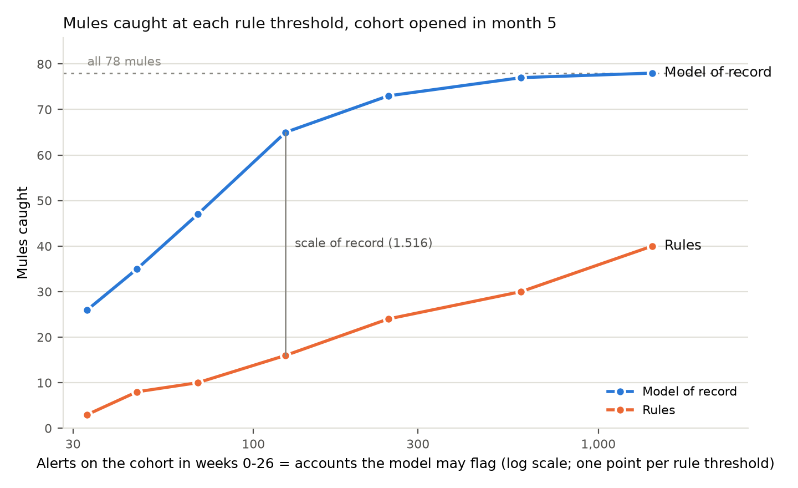

# Rules vs model at several alert volumes

Data `data/v1_full`, cohort months [5], weeks 0-26, model scores `data/v1_full/scores/frozen_tuned_avg5_m5.parquet`. Plan and limits: `../PLAN.md`. Made by `python -m evaluation.budget_curve`.

**Reading (fixed in the plan): the lead holds across thresholds** (the model catches more mules than the rules at 7 of 7 scales).

`budget` = the rules' alerts on the cohort in weeks 0-26 at that scale = the accounts the model may flag. `lead` = (model caught - rules caught) / mules.

|   scale |   budget |   mules |   rules_flagged |   rules_caught |   rules_precision |   model_flagged |   model_caught |   model_precision |   lead |   both |   model_only |   rules_only |
|--------:|---------:|--------:|----------------:|---------------:|------------------:|----------------:|---------------:|------------------:|-------:|-------:|-------------:|-------------:|
|   1     |     1432 |      78 |             961 |             40 |             0.042 |            1432 |             78 |             0.054 |  0.487 |     40 |           38 |            0 |
|   1.149 |      597 |      78 |             463 |             30 |             0.065 |             597 |             77 |             0.129 |  0.603 |     29 |           48 |            1 |
|   1.32  |      246 |      78 |             221 |             24 |             0.109 |             246 |             73 |             0.297 |  0.628 |     23 |           50 |            1 |
|   1.516 |      124 |      78 |             119 |             16 |             0.134 |             124 |             65 |             0.524 |  0.628 |     14 |           51 |            2 |
|   1.741 |       69 |      78 |              69 |             10 |             0.145 |              69 |             47 |             0.681 |  0.474 |      9 |           38 |            1 |
|   2     |       46 |      78 |              46 |              8 |             0.174 |              46 |             35 |             0.761 |  0.346 |      6 |           29 |            2 |
|   2.639 |       33 |      78 |              33 |              3 |             0.091 |              33 |             26 |             0.788 |  0.295 |      3 |           23 |            0 |

Approximate: closures in the data are those of the scale of record; see the plan's limits.
