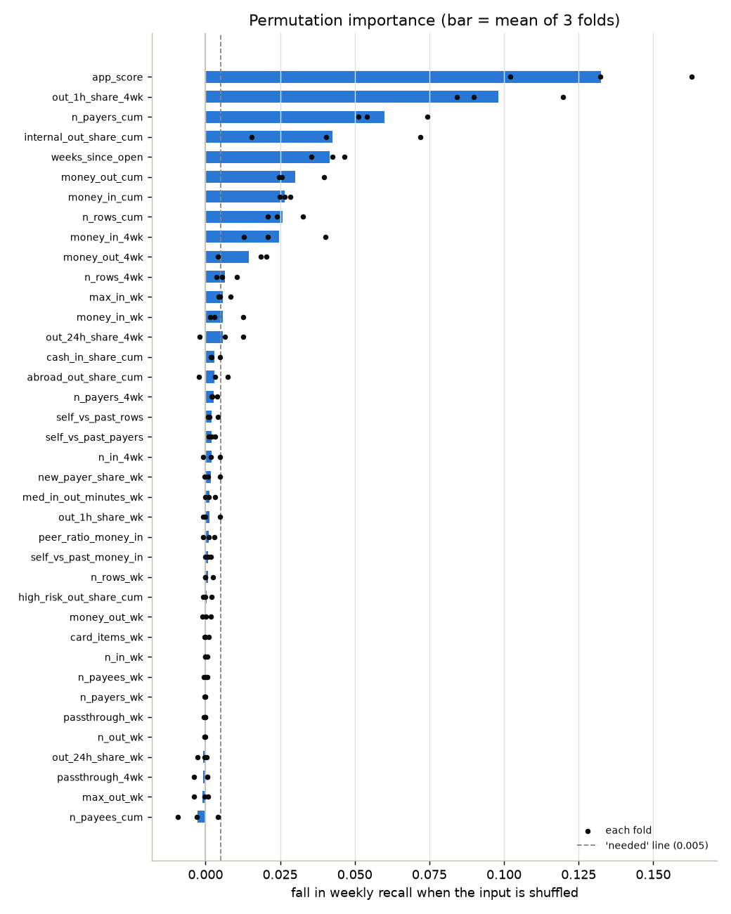

# Feature selection, steps 1-3 (v1_full)

Data `data/v1_full`, training months 0-4, weeks 0-26, 3 folds, seed 42, lightgbm 4.7.0. Executed copy: `07_feature_selection.ipynb`. Thresholds (assumptions): near-duplicates |rho| >= 0.8; 'needed' = weekly recall falls by >= 0.005 in all 3 folds when shuffled (3 shuffles per fold).

## Per input

| feature                 | family         |   screen_auc | screen_signal   |   all_weeks_auc | near_copy_group   |   perm_drop |   folds_down |   group_drop |   gain_share |   mean_abs_shap |   direction | label                  |
|:------------------------|:---------------|-------------:|:----------------|----------------:|:------------------|------------:|-------------:|-------------:|-------------:|----------------:|------------:|:-----------------------|
| app_score               | application    |       0.7962 | True            |          0.8052 |                   |      0.1324 |            3 |     nan      |       0.5084 |          1.1302 |      0.8698 | needed                 |
| out_1h_share_4wk        | window_4wk     |       0.9338 | True            |          0.6133 |                   |      0.098  |            3 |     nan      |       0.1146 |          0.0767 |      0.1372 | needed                 |
| n_payers_cum            | counterparties |       0.8335 | True            |          0.5605 |                   |      0.0599 |            3 |     nan      |       0.0665 |          0.1862 |     -0.2455 | needed                 |
| internal_out_share_cum  | mix            |       0.6234 | True            |          0.5337 |                   |      0.0426 |            3 |     nan      |       0.0406 |          0.1761 |     -0.2444 | needed                 |
| weeks_since_open        | clock          |       0.5    | False           |          0.4799 | C23               |      0.0416 |            3 |       0.0597 |       0.0189 |          0.5748 |     -0.8697 | needed                 |
| money_out_cum           | volume_cum     |       0.7452 | True            |          0.5661 | C22               |      0.03   |            3 |       0.0709 |       0.0196 |          0.1535 |      0.7178 | needed                 |
| money_in_cum            | volume_cum     |       0.7245 | True            |          0.5697 | C22               |      0.0266 |            3 |       0.0709 |       0.0218 |          0.14   |      0.823  | needed                 |
| n_rows_cum              | volume_cum     |       0.8642 | True            |          0.5161 | C23               |      0.0258 |            3 |       0.0597 |       0.0173 |          0.1303 |     -0.1034 | needed                 |
| money_in_4wk            | window_4wk     |       0.8298 | True            |          0.6205 |                   |      0.0247 |            3 |     nan      |       0.0659 |          0.174  |     -0.2595 | needed                 |
| money_out_4wk           | window_4wk     |       0.8549 | True            |          0.629  |                   |      0.0144 |            3 |     nan      |       0.0124 |          0.0576 |     -0.6216 | needed                 |
| n_rows_4wk              | window_4wk     |       0.8802 | True            |          0.5847 |                   |      0.0065 |            3 |     nan      |       0.0143 |          0.0374 |     -0.4234 | needed                 |
| max_in_wk               | volume_wk      |       0.6812 | True            |          0.5348 | C17               |      0.0059 |            3 |       0.0108 |       0.0113 |          0.0908 |     -0.3553 | needed                 |
| money_in_wk             | volume_wk      |       0.7088 | True            |          0.5411 | C17               |      0.0058 |            3 |       0.0108 |       0.0031 |          0.0319 |      0.4705 | needed                 |
| out_24h_share_4wk       | window_4wk     |       0.9081 | True            |          0.607  |                   |      0.0057 |            2 |     nan      |       0.0129 |          0.0631 |      0.7173 | mixed                  |
| cash_in_share_cum       | mix            |       0.571  | True            |          0.5266 |                   |      0.0029 |            3 |     nan      |       0.014  |          0.0218 |     -0.0193 | weak                   |
| abroad_out_share_cum    | mix            |       0.5392 | True            |          0.5131 |                   |      0.0029 |            2 |     nan      |       0.0101 |          0.0469 |     -0.2244 | weak                   |
| n_payers_4wk            | window_4wk     |       0.8305 | True            |          0.5756 | C18               |      0.0027 |            3 |       0.0057 |       0.0032 |          0.0345 |      0.0088 | covered by a near-copy |
| self_vs_past_rows       | self_vs_past   |       0.736  | True            |          0.5229 | C2                |      0.0021 |            3 |       0.0013 |       0.0023 |          0.0244 |      0.4102 | weak                   |
| self_vs_past_payers     | self_vs_past   |       0.6664 | True            |          0.5583 | C17               |      0.002  |            3 |       0.0108 |       0.0017 |          0.0176 |     -0.1466 | covered by a near-copy |
| n_in_4wk                | window_4wk     |       0.886  | True            |          0.5915 | C18               |      0.0019 |            2 |       0.0057 |       0.0029 |          0.0089 |      0.0315 | covered by a near-copy |
| new_payer_share_wk      | counterparties |       0.7096 | True            |          0.5316 |                   |      0.0018 |            2 |     nan      |       0.0006 |          0.0091 |      0.5414 | weak                   |
| med_in_out_minutes_wk   | flow           |       0.211  | True            |          0.4426 |                   |      0.0014 |            2 |     nan      |       0.002  |          0.0169 |      0.1864 | weak                   |
| out_1h_share_wk         | flow           |       0.7833 | True            |          0.5536 |                   |      0.0014 |            1 |     nan      |       0.0029 |          0.0096 |      0.2225 | weak                   |
| peer_ratio_money_in     | peer           |       0.7094 | True            |          0.5352 | C17               |      0.0012 |            2 |       0.0108 |       0.0037 |          0.0128 |      0.4736 | covered by a near-copy |
| self_vs_past_money_in   | self_vs_past   |       0.6809 | True            |          0.5617 | C17               |      0.0008 |            2 |       0.0108 |       0.0047 |          0.0267 |     -0.4169 | covered by a near-copy |
| n_rows_wk               | volume_wk      |       0.8045 | True            |          0.5506 | C2                |      0.0008 |            1 |       0.0013 |       0.0005 |          0.0127 |     -0.4417 | weak                   |
| high_risk_out_share_cum | mix            |       0.5203 | True            |          0.5075 |                   |      0.0003 |            1 |     nan      |       0.0026 |          0.0113 |     -0.1342 | weak                   |
| money_out_wk            | volume_wk      |       0.7527 | True            |          0.5986 | C12               |      0.0003 |            2 |      -0.001  |       0.0017 |          0.0125 |     -0.3037 | weak                   |
| card_items_wk           | volume_wk      |       0.5652 | True            |          0.5417 |                   |      0.0002 |            1 |     nan      |       0.0008 |          0.0041 |     -0.2389 | weak                   |
| n_in_wk                 | volume_wk      |       0.7642 | True            |          0.5492 | C17               |      0.0002 |            3 |       0.0108 |       0.0008 |          0.0043 |     -0.1321 | covered by a near-copy |
| n_payees_wk             | counterparties |       0.6907 | True            |          0.5304 | C1                |      0      |            2 |       0.0004 |       0.0004 |          0.0043 |     -0.239  | weak                   |
| n_payers_wk             | counterparties |       0.758  | True            |          0.5417 | C17               |     -0.0001 |            0 |       0.0108 |       0.0002 |          0.0011 |     -0.1134 | covered by a near-copy |
| passthrough_wk          | flow           |       0.7012 | True            |          0.5343 |                   |     -0.0002 |            1 |     nan      |       0.0008 |          0.0072 |     -0.167  | weak                   |
| n_out_wk                | volume_wk      |       0.7672 | True            |          0.541  | C1                |     -0.0003 |            1 |       0.0004 |       0.0002 |          0.0021 |     -0.5288 | weak                   |
| out_24h_share_wk        | flow           |       0.7546 | True            |          0.5498 |                   |     -0.0009 |            1 |     nan      |       0.0014 |          0.0084 |      0.3045 | weak                   |
| passthrough_4wk         | window_4wk     |       0.6021 | True            |          0.4918 |                   |     -0.0009 |            2 |     nan      |       0.0033 |          0.0219 |     -0.3521 | weak                   |
| max_out_wk              | volume_wk      |       0.7343 | True            |          0.5971 | C12               |     -0.0011 |            1 |      -0.001  |       0.0046 |          0.028  |      0.0551 | weak                   |
| n_payees_cum            | counterparties |       0.6582 | True            |          0.5001 | C23               |     -0.0026 |            1 |       0.0597 |       0.0071 |          0.0494 |     -0.536  | covered by a near-copy |

## Per family

| family         |   n |   perm_drop |   folds_down |   needed_members | family_needed   |
|:---------------|----:|------------:|-------------:|-----------------:|:----------------|
| volume_wk      |   8 |      0.006  |            3 |                2 | True            |
| volume_cum     |   3 |      0.0767 |            3 |                3 | True            |
| counterparties |   5 |      0.0597 |            3 |                1 | True            |
| flow           |   4 |      0.0039 |            3 |                0 | False           |
| self_vs_past   |   3 |      0.0023 |            2 |                0 | False           |
| peer           |   1 |      0.0012 |            2 |                0 | False           |
| mix            |   4 |      0.05   |            3 |                1 | True            |
| window_4wk     |   8 |      0.1477 |            3 |                4 | True            |
| clock          |   1 |      0.0416 |            3 |                1 | True            |
| application    |   1 |      0.1324 |            3 |                1 | True            |

## Near-duplicate groups (|rho| >= 0.8 for every pair)

|     | members                                                                                                       |   n |   min_abs_rho |
|:----|:--------------------------------------------------------------------------------------------------------------|----:|--------------:|
| C1  | n_out_wk, n_payees_wk                                                                                         |   2 |         0.935 |
| C2  | n_rows_wk, self_vs_past_rows                                                                                  |   2 |         0.87  |
| C12 | money_out_wk, max_out_wk                                                                                      |   2 |         0.83  |
| C17 | n_in_wk, money_in_wk, max_in_wk, n_payers_wk, self_vs_past_money_in, self_vs_past_payers, peer_ratio_money_in |   7 |         0.813 |
| C18 | n_in_4wk, n_payers_4wk                                                                                        |   2 |         0.962 |
| C22 | money_in_cum, money_out_cum                                                                                   |   2 |         0.965 |
| C23 | n_rows_cum, n_payees_cum, weeks_since_open                                                                    |   3 |         0.929 |

## Next step: confirm by refitting without them

- weak (16): cash_in_share_cum, abroad_out_share_cum, self_vs_past_rows, new_payer_share_wk, med_in_out_minutes_wk, out_1h_share_wk, n_rows_wk, high_risk_out_share_cum, money_out_wk, card_items_wk, n_payees_wk, passthrough_wk, n_out_wk, out_24h_share_wk, passthrough_4wk, max_out_wk
- spare near-copies (7): n_in_wk, n_payers_wk, self_vs_past_money_in, self_vs_past_payers, peer_ratio_money_in, n_in_4wk, n_payees_cum
- inputs left after trial 2: 15 of 38

`python -m models.feature_lab --out data/v1_full --drop cash_in_share_cum abroad_out_share_cum self_vs_past_rows new_payer_share_wk med_in_out_minutes_wk out_1h_share_wk n_rows_wk high_risk_out_share_cum money_out_wk card_items_wk n_payees_wk passthrough_wk n_out_wk out_24h_share_wk passthrough_4wk max_out_wk --together --name drop-weak-v1_full`

`python -m models.feature_lab --out data/v1_full --drop cash_in_share_cum abroad_out_share_cum self_vs_past_rows new_payer_share_wk med_in_out_minutes_wk out_1h_share_wk n_rows_wk high_risk_out_share_cum money_out_wk card_items_wk n_payees_wk passthrough_wk n_out_wk out_24h_share_wk passthrough_4wk max_out_wk n_in_wk n_payers_wk self_vs_past_money_in self_vs_past_payers peer_ratio_money_in n_in_4wk n_payees_cum --together --name drop-weak-and-copies-v1_full`

Labels are evidence, not decisions: the model's inputs change only by team decision after the refit trials above.
