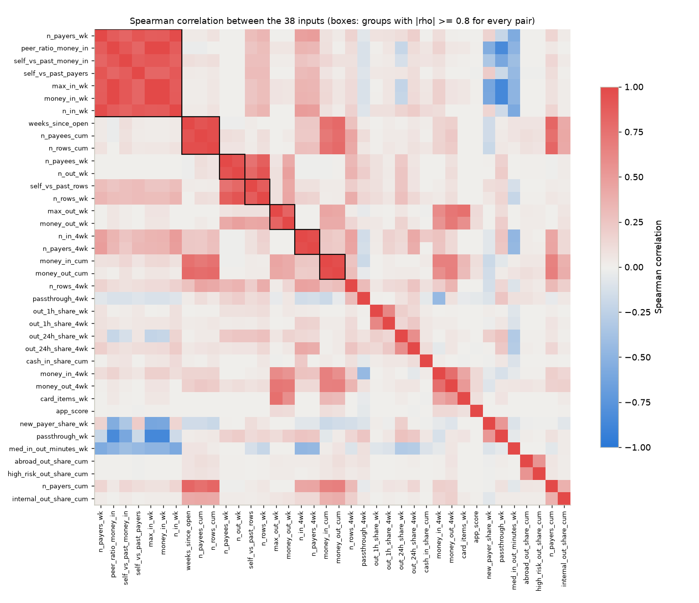

# Feature selection (v1_full): does each of the 38 frozen inputs earn its place?

Report-appendix work. The input list is frozen (decision 28 Oct 2026); nothing here changes it.

Data `data/v1_full`, training months 0-4, weeks 0-26, 3 folds, seed 42, lightgbm 4.7.0, LightGBM settings `outputs/modelling/models/v1_full/lgbm_tuning_step2/tuned_params.json`. Executed copy: `13_feature_selection.ipynb`. Thresholds (assumptions): near-duplicates |rho| >= 0.8; 'needed' = the measure falls by at least 0.005 (weekly recall) or 0.01 (catch_rules) in all 3 folds when shuffled (3 shuffles per fold).

## Baseline per fold

|   fold |   catch_rules |   weekly_recall |   rules_catch |
|-------:|--------------:|----------------:|--------------:|
|      1 |         0.464 |           0.428 |         0.146 |
|      2 |         0.455 |           0.397 |         0.132 |
|      3 |         0.436 |           0.47  |         0.143 |

`rules_catch` = catch_rules of the rules' own alerts on the same month.

## Per input

| feature                 | family         |   screen_auc | screen_signal   |   all_weeks_auc | near_copy_group   |   drop_weekly_recall |   folds_down_weekly_recall |   group_drop_weekly_recall |   drop_catch_rules |   folds_down_catch_rules |   group_drop_catch_rules |   gain_share |   mean_abs_shap |   direction | needed_on                  | label                  |
|:------------------------|:---------------|-------------:|:----------------|----------------:|:------------------|---------------------:|---------------------------:|---------------------------:|-------------------:|-------------------------:|-------------------------:|-------------:|----------------:|------------:|:---------------------------|:-----------------------|
| app_score               | application    |       0.7962 | True            |          0.8052 |                   |               0.1572 |                          3 |                   nan      |             0.0316 |                        3 |                 nan      |       0.5071 |          1.092  |      0.8701 | weekly_recall, catch_rules | needed                 |
| out_1h_share_4wk        | window_4wk     |       0.9338 | True            |          0.6133 |                   |               0.0845 |                          3 |                   nan      |             0.2599 |                        3 |                 nan      |       0.1182 |          0.0772 |      0.161  | weekly_recall, catch_rules | needed                 |
| n_payers_cum            | counterparties |       0.8335 | True            |          0.5605 |                   |               0.0566 |                          3 |                   nan      |            -0.0028 |                        1 |                 nan      |       0.0666 |          0.1978 |     -0.1982 | weekly_recall              | needed                 |
| weeks_since_open        | clock          |       0.5    | False           |          0.4799 | C23               |               0.0466 |                          3 |                     0.0579 |             0.0029 |                        3 |                   0.0031 |       0.0222 |          0.6217 |     -0.8899 | weekly_recall              | needed                 |
| internal_out_share_cum  | mix            |       0.6234 | True            |          0.5337 |                   |               0.0434 |                          3 |                   nan      |             0.0025 |                        1 |                 nan      |       0.0368 |          0.1527 |     -0.2505 | weekly_recall              | needed                 |
| money_out_cum           | volume_cum     |       0.7452 | True            |          0.5661 | C22               |               0.0375 |                          3 |                     0.0868 |            -0.0043 |                        1 |                   0.008  |       0.0239 |          0.1823 |      0.7739 | weekly_recall              | needed                 |
| money_in_cum            | volume_cum     |       0.7245 | True            |          0.5697 | C22               |               0.0269 |                          3 |                     0.0868 |             0.0019 |                        3 |                   0.008  |       0.0211 |          0.1604 |      0.8943 | weekly_recall              | needed                 |
| n_rows_cum              | volume_cum     |       0.8642 | True            |          0.5161 | C23               |               0.0221 |                          3 |                     0.0579 |             0.0024 |                        3 |                   0.0031 |       0.0186 |          0.1212 |     -0.0514 | weekly_recall              | needed                 |
| money_in_4wk            | window_4wk     |       0.8298 | True            |          0.6205 |                   |               0.0211 |                          3 |                   nan      |             0.0553 |                        3 |                 nan      |       0.0567 |          0.1671 |     -0.1531 | weekly_recall, catch_rules | needed                 |
| money_out_4wk           | window_4wk     |       0.8549 | True            |          0.629  |                   |               0.0195 |                          3 |                   nan      |            -0.0004 |                        2 |                 nan      |       0.0136 |          0.0785 |     -0.7774 | weekly_recall              | needed                 |
| max_in_wk               | volume_wk      |       0.6812 | True            |          0.5348 | C17               |               0.008  |                          3 |                     0.0078 |             0.0066 |                        3 |                  -0.0007 |       0.0118 |          0.0979 |     -0.475  | weekly_recall              | needed                 |
| out_24h_share_4wk       | window_4wk     |       0.9081 | True            |          0.607  |                   |               0.0072 |                          3 |                   nan      |             0.0127 |                        2 |                 nan      |       0.0141 |          0.057  |      0.6185 | weekly_recall              | needed                 |
| abroad_out_share_cum    | mix            |       0.5392 | True            |          0.5131 |                   |               0.0061 |                          3 |                   nan      |             0.0028 |                        2 |                 nan      |       0.0079 |          0.0525 |     -0.2464 | weekly_recall              | needed                 |
| cash_in_share_cum       | mix            |       0.571  | True            |          0.5266 |                   |               0.0054 |                          3 |                   nan      |            -0.0094 |                        0 |                 nan      |       0.0111 |          0.0273 |     -0.1104 | weekly_recall              | needed                 |
| n_rows_4wk              | window_4wk     |       0.8802 | True            |          0.5847 |                   |               0.0042 |                          3 |                   nan      |             0.0221 |                        3 |                 nan      |       0.0178 |          0.0344 |     -0.1018 | catch_rules                | needed                 |
| out_1h_share_wk         | flow           |       0.7833 | True            |          0.5536 |                   |               0.0035 |                          3 |                   nan      |             0.0077 |                        3 |                 nan      |       0.0041 |          0.0091 |      0.2527 |                            | weak                   |
| n_in_4wk                | window_4wk     |       0.886  | True            |          0.5915 | C18               |               0.0026 |                          3 |                     0.0061 |            -0.0034 |                        0 |                   0.003  |       0.004  |          0.0119 |     -0.1771 |                            | covered by a near-copy |
| n_payers_4wk            | window_4wk     |       0.8305 | True            |          0.5756 | C18               |               0.0025 |                          2 |                     0.0061 |             0.0005 |                        2 |                   0.003  |       0.0024 |          0.0478 |     -0.5609 |                            | covered by a near-copy |
| self_vs_past_rows       | self_vs_past   |       0.736  | True            |          0.5229 | C2                |               0.0021 |                          3 |                     0.0026 |             0.0036 |                        3 |                   0.0035 |       0.0025 |          0.031  |      0.5812 |                            | weak                   |
| money_in_wk             | volume_wk      |       0.7088 | True            |          0.5411 | C17               |               0.0016 |                          2 |                     0.0078 |             0.0007 |                        2 |                  -0.0007 |       0.0033 |          0.0363 |      0.5897 |                            | covered by a near-copy |
| peer_ratio_money_in     | peer           |       0.7094 | True            |          0.5352 | C17               |               0.0014 |                          3 |                     0.0078 |            -0.0026 |                        1 |                  -0.0007 |       0.0033 |          0.0118 |      0.225  |                            | covered by a near-copy |
| n_payees_cum            | counterparties |       0.6582 | True            |          0.5001 | C23               |               0.0014 |                          2 |                     0.0579 |            -0.0021 |                        0 |                   0.0031 |       0.007  |          0.0614 |     -0.5775 |                            | covered by a near-copy |
| self_vs_past_money_in   | self_vs_past   |       0.6809 | True            |          0.5617 | C17               |               0.0014 |                          2 |                     0.0078 |            -0.0028 |                        0 |                  -0.0007 |       0.0036 |          0.0194 |     -0.6354 |                            | covered by a near-copy |
| n_in_wk                 | volume_wk      |       0.7642 | True            |          0.5492 | C17               |               0.0012 |                          3 |                     0.0078 |            -0.0018 |                        1 |                  -0.0007 |       0.0008 |          0.0041 |      0.1829 |                            | covered by a near-copy |
| money_out_wk            | volume_wk      |       0.7527 | True            |          0.5986 | C12               |               0.0012 |                          3 |                     0.0002 |            -0.0013 |                        2 |                  -0      |       0.0021 |          0.0113 |     -0.0094 |                            | weak                   |
| passthrough_wk          | flow           |       0.7012 | True            |          0.5343 |                   |               0.0012 |                          3 |                   nan      |            -0.0033 |                        0 |                 nan      |       0.0006 |          0.0038 |     -0.2222 |                            | weak                   |
| max_out_wk              | volume_wk      |       0.7343 | True            |          0.5971 | C12               |               0.0012 |                          3 |                     0.0002 |            -0.0033 |                        0 |                  -0      |       0.0051 |          0.028  |      0.1382 |                            | weak                   |
| n_payees_wk             | counterparties |       0.6907 | True            |          0.5304 | C1                |               0.0008 |                          2 |                     0.0005 |            -0.0001 |                        0 |                  -0.0011 |       0.0005 |          0.0042 |     -0.5672 |                            | weak                   |
| n_out_wk                | volume_wk      |       0.7672 | True            |          0.541  | C1                |               0.0007 |                          2 |                     0.0005 |             0      |                        0 |                  -0.0011 |       0.0002 |          0.0017 |     -0.3961 |                            | weak                   |
| out_24h_share_wk        | flow           |       0.7546 | True            |          0.5498 |                   |               0.0006 |                          3 |                   nan      |            -0.0055 |                        0 |                 nan      |       0.0015 |          0.0093 |     -0.135  |                            | weak                   |
| card_items_wk           | volume_wk      |       0.5652 | True            |          0.5417 |                   |               0.0003 |                          2 |                   nan      |            -0.0011 |                        0 |                 nan      |       0.0008 |          0.0041 |      0.0033 |                            | weak                   |
| med_in_out_minutes_wk   | flow           |       0.211  | True            |          0.4426 |                   |               0      |                          1 |                   nan      |            -0.0017 |                        1 |                 nan      |       0.0017 |          0.0134 |      0.4134 |                            | weak                   |
| new_payer_share_wk      | counterparties |       0.7096 | True            |          0.5316 |                   |              -0.0001 |                          1 |                   nan      |            -0.0043 |                        1 |                 nan      |       0.0009 |          0.0055 |      0.3524 |                            | weak                   |
| n_payers_wk             | counterparties |       0.758  | True            |          0.5417 | C17               |              -0.0001 |                          1 |                     0.0078 |             0      |                        0 |                  -0.0007 |       0.0001 |          0.0006 |      0.1026 |                            | covered by a near-copy |
| passthrough_4wk         | window_4wk     |       0.6021 | True            |          0.4918 |                   |              -0.0002 |                          1 |                   nan      |            -0.0035 |                        1 |                 nan      |       0.0028 |          0.0223 |     -0.5913 |                            | weak                   |
| n_rows_wk               | volume_wk      |       0.8045 | True            |          0.5506 | C2                |              -0.0003 |                          2 |                     0.0026 |            -0.0041 |                        0 |                   0.0035 |       0.0007 |          0.0137 |     -0.467  |                            | weak                   |
| high_risk_out_share_cum | mix            |       0.5203 | True            |          0.5075 |                   |              -0.0005 |                          2 |                   nan      |            -0.0021 |                        0 |                 nan      |       0.0017 |          0.0092 |     -0.1521 |                            | weak                   |
| self_vs_past_payers     | self_vs_past   |       0.6664 | True            |          0.5583 | C17               |              -0.0011 |                          1 |                     0.0078 |            -0.0041 |                        0 |                  -0.0007 |       0.0029 |          0.0168 |      0.0147 |                            | covered by a near-copy |

## Per family

| family         |   n |   drop_weekly_recall |   folds_down_weekly_recall |   drop_catch_rules |   folds_down_catch_rules |   needed_members | family_needed   |
|:---------------|----:|---------------------:|---------------------------:|-------------------:|-------------------------:|-----------------:|:----------------|
| volume_wk      |   8 |               0.0077 |                          3 |             0.0041 |                        2 |                1 | True            |
| volume_cum     |   3 |               0.0915 |                          3 |             0.0163 |                        3 |                3 | True            |
| counterparties |   5 |               0.0613 |                          3 |            -0.0009 |                        1 |                1 | True            |
| flow           |   4 |               0.0046 |                          3 |             0.0063 |                        2 |                0 | False           |
| self_vs_past   |   3 |               0.0042 |                          3 |             0.0045 |                        3 |                0 | False           |
| peer           |   1 |               0.0014 |                          3 |            -0.0026 |                        1 |                0 | False           |
| mix            |   4 |               0.0517 |                          3 |             0.0016 |                        1 |                3 | True            |
| window_4wk     |   8 |               0.1484 |                          3 |             0.3414 |                        3 |                5 | True            |
| clock          |   1 |               0.0466 |                          3 |             0.0029 |                        3 |                1 | True            |
| application    |   1 |               0.1572 |                          3 |             0.0316 |                        3 |                1 | True            |

## Near-duplicate groups (|rho| >= 0.8 for every pair)

|     | members                                                                                                       |   n |   min_abs_rho |
|:----|:--------------------------------------------------------------------------------------------------------------|----:|--------------:|
| C1  | n_out_wk, n_payees_wk                                                                                         |   2 |         0.935 |
| C2  | n_rows_wk, self_vs_past_rows                                                                                  |   2 |         0.87  |
| C12 | money_out_wk, max_out_wk                                                                                      |   2 |         0.83  |
| C17 | n_in_wk, money_in_wk, max_in_wk, n_payers_wk, self_vs_past_money_in, self_vs_past_payers, peer_ratio_money_in |   7 |         0.813 |
| C18 | n_in_4wk, n_payers_4wk                                                                                        |   2 |         0.962 |
| C22 | money_in_cum, money_out_cum                                                                                   |   2 |         0.965 |
| C23 | n_rows_cum, n_payees_cum, weeks_since_open                                                                    |   3 |         0.929 |

## Refit check: the model without them

- weak (14): out_1h_share_wk, self_vs_past_rows, money_out_wk, passthrough_wk, max_out_wk, n_payees_wk, n_out_wk, out_24h_share_wk, card_items_wk, med_in_out_minutes_wk, new_payer_share_wk, passthrough_4wk, n_rows_wk, high_risk_out_share_cum
- spare near-copies (8): n_in_wk, money_in_wk, n_payers_wk, self_vs_past_money_in, self_vs_past_payers, peer_ratio_money_in, n_payers_4wk, n_payees_cum
- inputs left after trial 2: 16 of 38

`python -m models.feature_lab --out data/v1_full --drop out_1h_share_wk self_vs_past_rows money_out_wk passthrough_wk max_out_wk n_payees_wk n_out_wk out_24h_share_wk card_items_wk med_in_out_minutes_wk new_payer_share_wk passthrough_4wk n_rows_wk high_risk_out_share_cum --together --params outputs/modelling/models/v1_full/lgbm_tuning_step2/tuned_params.json --name drop-weak-tuned-v1_full`

`python -m models.feature_lab --out data/v1_full --drop out_1h_share_wk self_vs_past_rows money_out_wk passthrough_wk max_out_wk n_payees_wk n_out_wk out_24h_share_wk card_items_wk med_in_out_minutes_wk new_payer_share_wk passthrough_4wk n_rows_wk high_risk_out_share_cum n_in_wk money_in_wk n_payers_wk self_vs_past_money_in self_vs_past_payers peer_ratio_money_in n_payers_4wk n_payees_cum --together --params outputs/modelling/models/v1_full/lgbm_tuning_step2/tuned_params.json --name drop-weak-and-copies-tuned-v1_full`

Labels are evidence for the appendix, not decisions: the input list is frozen and changes only by team decision.
