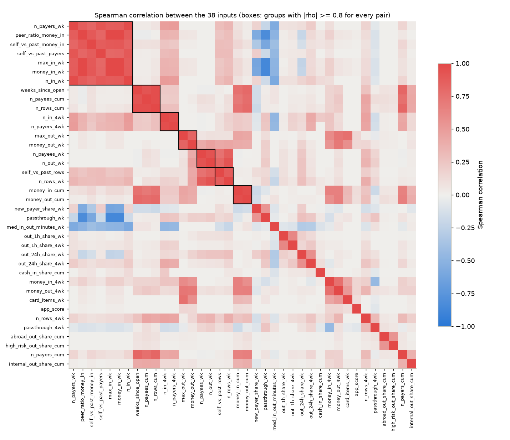
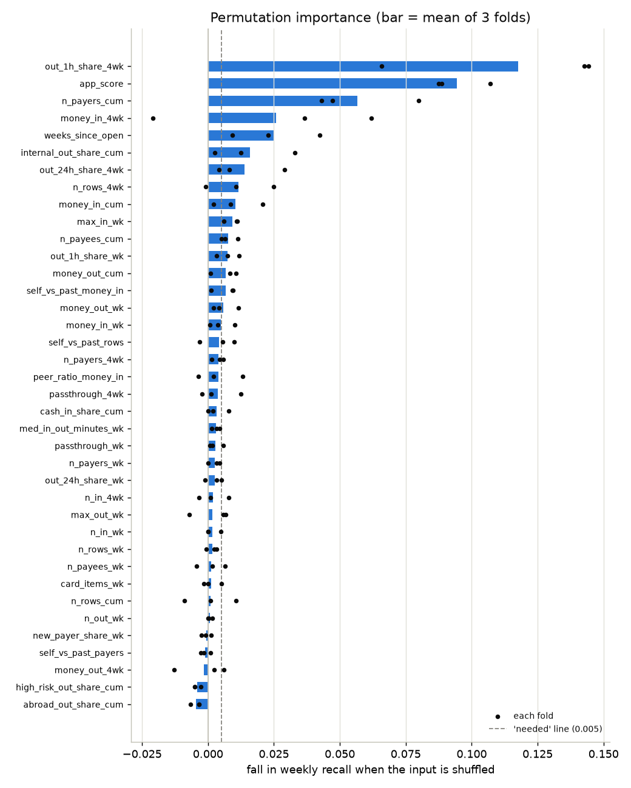

# Feature selection, steps 1-3 (v1)

Data `data/v1`, training months 0-4, weeks 0-26, 3 folds, seed 42, lightgbm 4.7.0. Executed copy: `07_feature_selection.ipynb`. Thresholds (assumptions): near-duplicates |rho| >= 0.8; 'needed' = weekly recall falls by >= 0.005 in all 3 folds when shuffled (3 shuffles per fold).

## Per input

| feature                 | family         |   screen_auc | screen_signal   |   all_weeks_auc | near_copy_group   |   perm_drop |   folds_down |   group_drop |   gain_share |   mean_abs_shap |   direction | label                  |
|:------------------------|:---------------|-------------:|:----------------|----------------:|:------------------|------------:|-------------:|-------------:|-------------:|----------------:|------------:|:-----------------------|
| out_1h_share_4wk        | window_4wk     |       0.959  | True            |          0.6292 |                   |      0.1176 |            3 |     nan      |       0.0908 |          0.0764 |      0.304  | needed                 |
| app_score               | application    |       0.8016 | True            |          0.7997 |                   |      0.0944 |            3 |     nan      |       0.5204 |          0.9477 |      0.6864 | needed                 |
| n_payers_cum            | counterparties |       0.8285 | True            |          0.5833 |                   |      0.0568 |            3 |     nan      |       0.0523 |          0.1967 |      0.6368 | needed                 |
| money_in_4wk            | window_4wk     |       0.8686 | True            |          0.6508 |                   |      0.0259 |            2 |     nan      |       0.0688 |          0.2345 |     -0.0538 | mixed                  |
| weeks_since_open        | clock          |       0.5    | False           |          0.4797 | C23               |      0.0248 |            3 |       0.047  |       0.0108 |          0.3891 |     -0.9079 | needed                 |
| internal_out_share_cum  | mix            |       0.657  | True            |          0.5563 |                   |      0.0159 |            3 |     nan      |       0.0344 |          0.1948 |      0.087  | needed                 |
| out_24h_share_4wk       | window_4wk     |       0.9482 | True            |          0.6081 |                   |      0.0138 |            3 |     nan      |       0.0167 |          0.1391 |     -0.1415 | needed                 |
| n_rows_4wk              | window_4wk     |       0.918  | True            |          0.6085 |                   |      0.0116 |            2 |     nan      |       0.0099 |          0.0707 |      0.2997 | mixed                  |
| money_in_cum            | volume_cum     |       0.7356 | True            |          0.5882 | C22               |      0.0105 |            3 |       0.0157 |       0.0109 |          0.1141 |      0.4844 | needed                 |
| max_in_wk               | volume_wk      |       0.645  | True            |          0.5481 | C3                |      0.0093 |            3 |       0.0163 |       0.007  |          0.1145 |     -0.4602 | needed                 |
| n_payees_cum            | counterparties |       0.6972 | True            |          0.5117 | C23               |      0.0076 |            3 |       0.047  |       0.0296 |          0.2973 |     -0.681  | needed                 |
| out_1h_share_wk         | flow           |       0.7537 | True            |          0.5665 |                   |      0.0075 |            3 |     nan      |       0.001  |          0.0097 |      0.1855 | needed                 |
| money_out_cum           | volume_cum     |       0.7494 | True            |          0.5819 | C22               |      0.0067 |            3 |       0.0157 |       0.0084 |          0.0872 |      0.2176 | needed                 |
| self_vs_past_money_in   | self_vs_past   |       0.6925 | True            |          0.5842 | C3                |      0.0066 |            3 |       0.0163 |       0.012  |          0.0884 |      0.2195 | needed                 |
| money_out_wk            | volume_wk      |       0.6763 | True            |          0.6207 | C13               |      0.0059 |            3 |       0.0066 |       0.0031 |          0.04   |     -0.074  | needed                 |
| money_in_wk             | volume_wk      |       0.6749 | True            |          0.5549 | C3                |      0.0049 |            3 |       0.0163 |       0.0015 |          0.0465 |     -0.1087 | covered by a near-copy |
| self_vs_past_rows       | self_vs_past   |       0.6174 | True            |          0.5213 | C17               |      0.0041 |            2 |       0.0063 |       0.0014 |          0.028  |      0.1635 | covered by a near-copy |
| n_payers_4wk            | window_4wk     |       0.8787 | True            |          0.5887 | C4                |      0.0039 |            3 |       0.0058 |       0.0026 |          0.0176 |      0.2799 | weak                   |
| peer_ratio_money_in     | peer           |       0.6855 | True            |          0.5532 | C3                |      0.0039 |            2 |       0.0163 |       0.0018 |          0.0222 |      0.2916 | covered by a near-copy |
| passthrough_4wk         | window_4wk     |       0.4332 | True            |          0.4935 |                   |      0.0038 |            2 |     nan      |       0.0046 |          0.0668 |      0.2007 | weak                   |
| cash_in_share_cum       | mix            |       0.6049 | True            |          0.5511 |                   |      0.0033 |            3 |     nan      |       0.0223 |          0.0621 |      0.0255 | weak                   |
| med_in_out_minutes_wk   | flow           |       0.2261 | True            |          0.4294 |                   |      0.003  |            3 |     nan      |       0.0021 |          0.0419 |      0.3959 | weak                   |
| passthrough_wk          | flow           |       0.707  | True            |          0.5469 |                   |      0.0028 |            3 |     nan      |       0.0012 |          0.0198 |     -0.1347 | weak                   |
| n_payers_wk             | counterparties |       0.7055 | True            |          0.5494 | C3                |      0.0025 |            2 |       0.0163 |       0.0001 |          0.0042 |     -0.1306 | covered by a near-copy |
| out_24h_share_wk        | flow           |       0.7259 | True            |          0.5609 |                   |      0.0025 |            2 |     nan      |       0.0014 |          0.0323 |      0.0703 | weak                   |
| n_in_4wk                | window_4wk     |       0.9333 | True            |          0.6131 | C4                |      0.0018 |            2 |       0.0058 |       0.0026 |          0.0261 |      0.0687 | weak                   |
| max_out_wk              | volume_wk      |       0.686  | True            |          0.6203 | C13               |      0.0017 |            2 |       0.0066 |       0.0058 |          0.0484 |      0.0655 | weak                   |
| n_in_wk                 | volume_wk      |       0.7522 | True            |          0.5647 | C3                |      0.0016 |            1 |       0.0163 |       0.0003 |          0.0028 |     -0.0674 | covered by a near-copy |
| n_rows_wk               | volume_wk      |       0.6258 | True            |          0.5647 | C17               |      0.0016 |            2 |       0.0063 |       0.0011 |          0.0147 |     -0.0972 | covered by a near-copy |
| n_payees_wk             | counterparties |       0.5113 | False           |          0.5364 | C16               |      0.0013 |            2 |       0.0016 |       0.0008 |          0.0219 |      0.5282 | weak                   |
| card_items_wk           | volume_wk      |       0.5458 | False           |          0.5557 |                   |      0.0012 |            1 |     nan      |       0.002  |          0.0452 |      0.0961 | weak                   |
| n_rows_cum              | volume_cum     |       0.8182 | True            |          0.5274 | C23               |      0.0009 |            2 |       0.047  |       0.0168 |          0.1716 |     -0.5653 | covered by a near-copy |
| n_out_wk                | volume_wk      |       0.5505 | False           |          0.5484 | C16               |      0.0006 |            2 |       0.0016 |       0.0006 |          0.0102 |      0.0167 | weak                   |
| new_payer_share_wk      | counterparties |       0.693  | True            |          0.5383 |                   |     -0.0007 |            1 |     nan      |       0.0012 |          0.0858 |      0.8283 | weak                   |
| self_vs_past_payers     | self_vs_past   |       0.659  | True            |          0.5731 | C3                |     -0.0012 |            1 |       0.0163 |       0.005  |          0.0744 |     -0.0241 | covered by a near-copy |
| money_out_4wk           | window_4wk     |       0.8859 | True            |          0.6536 |                   |     -0.0015 |            2 |     nan      |       0.0137 |          0.0855 |     -0.2047 | weak                   |
| high_risk_out_share_cum | mix            |       0.538  | True            |          0.5204 |                   |     -0.0042 |            0 |     nan      |       0.0067 |          0.0128 |      0.0857 | weak                   |
| abroad_out_share_cum    | mix            |       0.6054 | True            |          0.5437 |                   |     -0.0045 |            0 |     nan      |       0.0283 |          0.0677 |      0.1454 | weak                   |

## Per family

| family         |   n |   perm_drop |   folds_down |   needed_members | family_needed   |
|:---------------|----:|------------:|-------------:|-----------------:|:----------------|
| volume_wk      |   8 |      0.0145 |            3 |                2 | True            |
| volume_cum     |   3 |      0.0175 |            3 |                2 | True            |
| counterparties |   5 |      0.0589 |            3 |                2 | True            |
| flow           |   4 |      0.011  |            3 |                1 | True            |
| self_vs_past   |   3 |      0.0073 |            3 |                1 | True            |
| peer           |   1 |      0.0039 |            2 |                0 | False           |
| mix            |   4 |      0.0184 |            3 |                1 | True            |
| window_4wk     |   8 |      0.1269 |            3 |                2 | True            |
| clock          |   1 |      0.0248 |            3 |                1 | True            |
| application    |   1 |      0.0944 |            3 |                1 | True            |

## Near-duplicate groups (|rho| >= 0.8 for every pair)

|     | members                                                                                                       |   n |   min_abs_rho |
|:----|:--------------------------------------------------------------------------------------------------------------|----:|--------------:|
| C3  | n_in_wk, money_in_wk, max_in_wk, n_payers_wk, self_vs_past_money_in, self_vs_past_payers, peer_ratio_money_in |   7 |         0.812 |
| C4  | n_in_4wk, n_payers_4wk                                                                                        |   2 |         0.962 |
| C13 | money_out_wk, max_out_wk                                                                                      |   2 |         0.828 |
| C16 | n_out_wk, n_payees_wk                                                                                         |   2 |         0.935 |
| C17 | n_rows_wk, self_vs_past_rows                                                                                  |   2 |         0.871 |
| C22 | money_in_cum, money_out_cum                                                                                   |   2 |         0.965 |
| C23 | n_rows_cum, n_payees_cum, weeks_since_open                                                                    |   3 |         0.929 |

## Next step: confirm by refitting without them

- weak (15): n_payers_4wk, passthrough_4wk, cash_in_share_cum, med_in_out_minutes_wk, passthrough_wk, out_24h_share_wk, n_in_4wk, max_out_wk, n_payees_wk, card_items_wk, n_out_wk, new_payer_share_wk, money_out_4wk, high_risk_out_share_cum, abroad_out_share_cum
- spare near-copies (7): n_in_wk, money_in_wk, n_payers_wk, self_vs_past_payers, peer_ratio_money_in, n_rows_wk, n_rows_cum
- inputs left after trial 2: 16 of 38

`python -m models.feature_lab --out data/v1 --drop n_payers_4wk passthrough_4wk cash_in_share_cum med_in_out_minutes_wk passthrough_wk out_24h_share_wk n_in_4wk max_out_wk n_payees_wk card_items_wk n_out_wk new_payer_share_wk money_out_4wk high_risk_out_share_cum abroad_out_share_cum --together --name drop-weak-v1`

`python -m models.feature_lab --out data/v1 --drop n_payers_4wk passthrough_4wk cash_in_share_cum med_in_out_minutes_wk passthrough_wk out_24h_share_wk n_in_4wk max_out_wk n_payees_wk card_items_wk n_out_wk new_payer_share_wk money_out_4wk high_risk_out_share_cum abroad_out_share_cum n_in_wk money_in_wk n_payers_wk self_vs_past_payers peer_ratio_money_in n_rows_wk n_rows_cum --together --name drop-weak-and-copies-v1`

Labels are evidence, not decisions: the model's inputs change only by team decision after the refit trials above.
