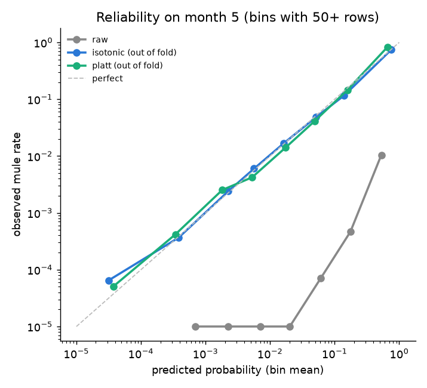

# Calibration of `frozen_tuned` on month 5

786,121 open account-weeks of month 5 (weeks 0-26), 1,848 of them mule weeks (0.235%). Chosen: **isotonic** (lower out-of-fold Brier score), refitted on all of month 5 -> `outputs/modelling/models/v1_full/frozen_tuned/calibration.json`. Machine: `{"os": "macOS-26.5.2-arm64-arm-64bit", "processor": "arm", "cpu_count": 8, "python": "3.12.3"}`.

## Quality (calibrated rows scored out of fold: 5 groups of month-5 accounts)

| scores   |   brier |   log_loss |   mean_predicted |   observed_rate |
|:---------|--------:|-----------:|-----------------:|----------------:|
| raw      | 0.07489 |    0.25707 |          0.18589 |         0.00235 |
| isotonic | 0.00181 |    0.01002 |          0.00235 |         0.00235 |
| platt    | 0.00183 |    0.00998 |          0.00240 |         0.00235 |

Brier score and log loss: lower is better. mean_predicted should be close to observed_rate.

## Reliability: predicted vs observed mule rate by predicted-probability bin

| bin             |   rows |   mules |   predicted |   observed | scores                 |
|:----------------|-------:|--------:|------------:|-----------:|:-----------------------|
| [0.0001, 0.001) |    116 |       0 |     0.00069 |    0.00000 | raw                    |
| [0.001, 0.003)  |   1572 |       0 |     0.00225 |    0.00000 | raw                    |
| [0.003, 0.01)   |  21235 |       0 |     0.00701 |    0.00000 | raw                    |
| [0.01, 0.03)    | 109031 |       0 |     0.02021 |    0.00000 | raw                    |
| [0.03, 0.1)     | 254457 |      18 |     0.06089 |    0.00007 | raw                    |
| [0.1, 0.3)      | 234763 |     109 |     0.17525 |    0.00046 | raw                    |
| [0.3, 1.0)      | 164947 |    1721 |     0.52828 |    0.01043 | raw                    |
| [0.0, 0.0001)   | 354902 |      23 |     0.00003 |    0.00006 | isotonic (out of fold) |
| [0.0001, 0.001) | 251677 |      92 |     0.00038 |    0.00037 | isotonic (out of fold) |
| [0.001, 0.003)  | 118569 |     286 |     0.00226 |    0.00241 | isotonic (out of fold) |
| [0.003, 0.01)   |  32303 |     194 |     0.00565 |    0.00601 | isotonic (out of fold) |
| [0.01, 0.03)    |  20120 |     335 |     0.01617 |    0.01665 | isotonic (out of fold) |
| [0.03, 0.1)     |   7016 |     338 |     0.05112 |    0.04818 | isotonic (out of fold) |
| [0.1, 0.3)      |    893 |     104 |     0.14060 |    0.11646 | isotonic (out of fold) |
| [0.3, 1.0)      |    641 |     476 |     0.75172 |    0.74259 | isotonic (out of fold) |
| [0.0, 0.0001)   | 334788 |      17 |     0.00004 |    0.00005 | platt (out of fold)    |
| [0.0001, 0.001) | 292096 |     122 |     0.00034 |    0.00042 | platt (out of fold)    |
| [0.001, 0.003)  |  80153 |     203 |     0.00182 |    0.00253 | platt (out of fold)    |
| [0.003, 0.01)   |  46960 |     198 |     0.00526 |    0.00422 | platt (out of fold)    |
| [0.01, 0.03)    |  20964 |     296 |     0.01740 |    0.01412 | platt (out of fold)    |
| [0.03, 0.1)     |   9113 |     373 |     0.04864 |    0.04093 | platt (out of fold)    |
| [0.1, 0.3)      |   1544 |     224 |     0.15709 |    0.14508 | platt (out of fold)    |
| [0.3, 1.0)      |    503 |     415 |     0.65518 |    0.82505 | platt (out of fold)    |

Calibration keeps the order of the scores, so the harness's caught counts and precision at the rules' budget do not change; it turns scores into probabilities for reporting.
