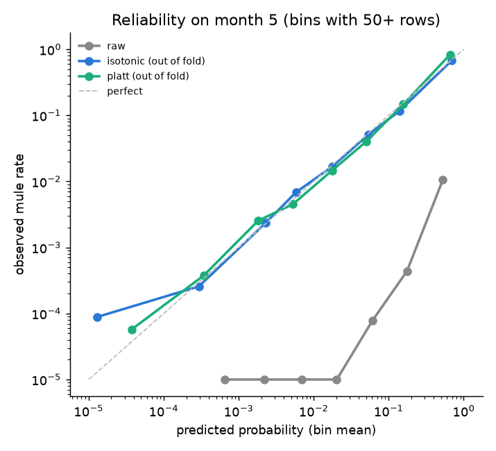

# Calibration of `frozen_tuned_avg5` on month 5

786,121 open account-weeks of month 5 (weeks 0-26), 1,848 of them mule weeks (0.235%). Chosen: **isotonic** (lower out-of-fold Brier score), refitted on all of month 5 -> `outputs/modelling/models/v1_full/frozen_tuned_avg5/calibration.json`. Machine: `{"os": "macOS-26.5.1-arm64-arm-64bit", "processor": "arm", "cpu_count": 15, "python": "3.12.15"}`.

## Quality (calibrated rows scored out of fold: 5 groups of month-5 accounts)

| scores   |   brier |   log_loss |   mean_predicted |   observed_rate |
|:---------|--------:|-----------:|-----------------:|----------------:|
| raw      | 0.07421 |    0.25581 |          0.18561 |         0.00235 |
| isotonic | 0.00180 |    0.00998 |          0.00235 |         0.00235 |
| platt    | 0.00183 |    0.00998 |          0.00240 |         0.00235 |

Brier score and log loss: lower is better. mean_predicted should be close to observed_rate.

## Reliability: predicted vs observed mule rate by predicted-probability bin

| bin             |   rows |   mules |   predicted |   observed | scores                 |
|:----------------|-------:|--------:|------------:|-----------:|:-----------------------|
| [0.0001, 0.001) |    115 |       0 |     0.00066 |    0.00000 | raw                    |
| [0.001, 0.003)  |   1830 |       0 |     0.00219 |    0.00000 | raw                    |
| [0.003, 0.01)   |  21427 |       0 |     0.00698 |    0.00000 | raw                    |
| [0.01, 0.03)    | 106906 |       0 |     0.02030 |    0.00000 | raw                    |
| [0.03, 0.1)     | 253149 |      20 |     0.06109 |    0.00008 | raw                    |
| [0.1, 0.3)      | 238115 |     104 |     0.17494 |    0.00044 | raw                    |
| [0.3, 1.0)      | 164579 |    1724 |     0.52538 |    0.01048 | raw                    |
| [0.0, 0.0001)   | 270612 |      24 |     0.00001 |    0.00009 | isotonic (out of fold) |
| [0.0001, 0.001) | 334813 |      86 |     0.00029 |    0.00026 | isotonic (out of fold) |
| [0.001, 0.003)  | 115726 |     272 |     0.00229 |    0.00235 | isotonic (out of fold) |
| [0.003, 0.01)   |  39339 |     269 |     0.00580 |    0.00684 | isotonic (out of fold) |
| [0.01, 0.03)    |  17602 |     293 |     0.01753 |    0.01665 | isotonic (out of fold) |
| [0.03, 0.1)     |   6763 |     345 |     0.05334 |    0.05101 | isotonic (out of fold) |
| [0.1, 0.3)      |    527 |      61 |     0.13843 |    0.11575 | isotonic (out of fold) |
| [0.3, 1.0)      |    739 |     498 |     0.68962 |    0.67388 | isotonic (out of fold) |
| [0.0, 0.0001)   | 329768 |      19 |     0.00004 |    0.00006 | platt (out of fold)    |
| [0.0001, 0.001) | 296272 |     111 |     0.00034 |    0.00037 | platt (out of fold)    |
| [0.001, 0.003)  |  81907 |     208 |     0.00182 |    0.00254 | platt (out of fold)    |
| [0.003, 0.01)   |  46319 |     209 |     0.00527 |    0.00451 | platt (out of fold)    |
| [0.01, 0.03)    |  20802 |     304 |     0.01753 |    0.01461 | platt (out of fold)    |
| [0.03, 0.1)     |   9073 |     361 |     0.04972 |    0.03979 | platt (out of fold)    |
| [0.1, 0.3)      |   1474 |     216 |     0.15652 |    0.14654 | platt (out of fold)    |
| [0.3, 1.0)      |    506 |     420 |     0.65620 |    0.83004 | platt (out of fold)    |

Calibration keeps the order of the scores, so the harness's caught counts and precision at the rules' budget do not change; it turns scores into probabilities for reporting.
