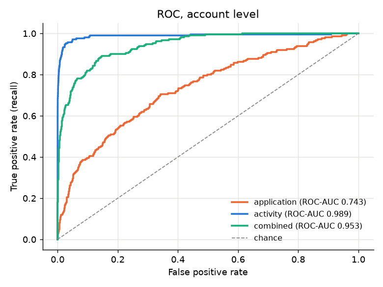
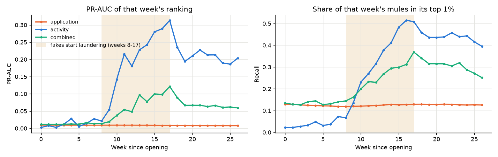
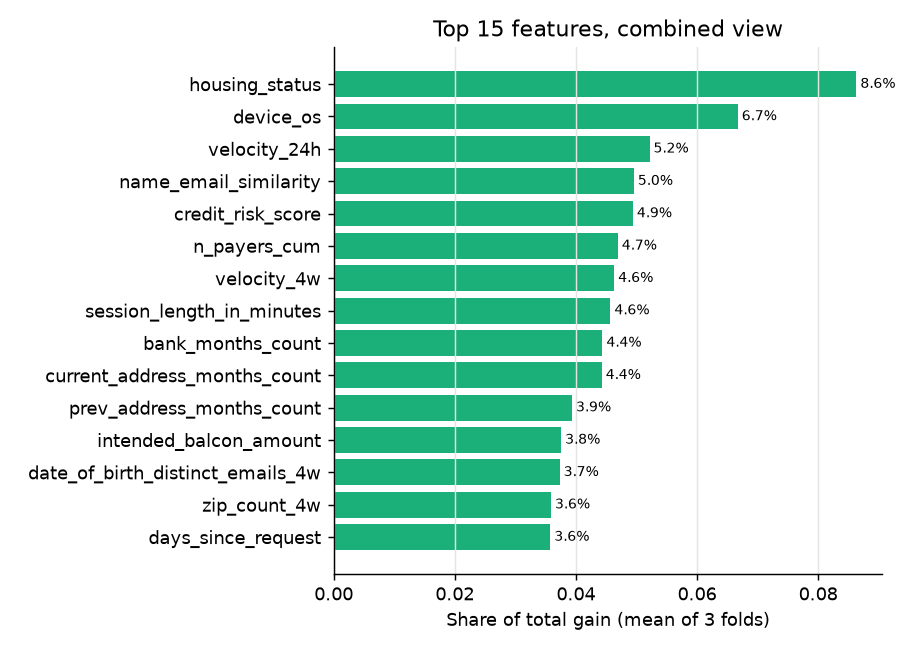

# LightGBM baseline (untuned), 3 temporal folds

Settings: `{"data": "data/v1_full", "weeks": [0, 26], "folds": ["(0, 1) -> 2", "(0, 1, 2) -> 3", "(0, 1, 2, 3) -> 4"], "dropped_features": [], "model": "LGBMClassifier(class_weight='balanced', deterministic=True), defaults otherwise", "seed": 42, "lightgbm": "4.7.0"}`

## Account level, mean of 3 folds (min to max)

| view | ROC-AUC | PR-AUC | P @0.5 | R @0.5 | F1 @0.5 | P @best | R @best | F1 @best | P top 1% | R top 1% | F1 top 1% |
|---|---|---|---|---|---|---|---|---|---|---|---|
| application | 0.743 (0.72-0.77) | 0.011 (0.01-0.02) | 0.017 (0.01-0.02) | 0.115 (0.05-0.18) | 0.028 (0.02-0.04) | 0.052 (0.01-0.10) | 0.106 (0.05-0.16) | 0.051 (0.02-0.06) | 0.020 (0.01-0.04) | 0.092 (0.05-0.16) | 0.033 (0.02-0.06) |
| activity | 0.989 (0.98-1.00) | 0.730 (0.67-0.77) | 0.003 (0.00-0.00) | 0.996 (0.99-1.00) | 0.005 (0.00-0.01) | 0.797 (0.70-0.90) | 0.668 (0.62-0.74) | 0.724 (0.66-0.76) | 0.181 (0.16-0.21) | 0.871 (0.86-0.89) | 0.300 (0.28-0.34) |
| combined | 0.953 (0.95-0.96) | 0.256 (0.17-0.40) | 0.040 (0.02-0.07) | 0.715 (0.55-0.87) | 0.073 (0.04-0.12) | 0.375 (0.32-0.43) | 0.289 (0.21-0.43) | 0.322 (0.26-0.43) | 0.112 (0.08-0.17) | 0.526 (0.44-0.70) | 0.185 (0.14-0.27) |

- **@0.5**: flag accounts whose highest weekly score is at least 0.5. With class weights this flags far more accounts than a bank could review.
- **@best**: the threshold with the highest F1 on that fold's own validation month (optimistic: the threshold is chosen on the data it is scored on).
- **top 1%**: flag the 1% highest-scoring accounts, the review-budget view the project uses.

## Each fold

|   fold | train_months   |   valid_month | view        |   accounts |   account_mules |   acc_pr_auc |   acc_top_1%_precision |   acc_top_1%_recall |   acc_top_1%_f1 | top_1%_fake   | top_1%_witting   | top_1%_unwitting   |
|-------:|:---------------|--------------:|:------------|-----------:|----------------:|-------------:|-----------------------:|--------------------:|----------------:|:--------------|:-----------------|:-------------------|
|      1 | 0-1            |             2 | application |      33523 |              64 |        0.012 |                  0.009 |               0.047 |           0.015 | 3/56          | 0/3              | 0/5                |
|      1 | 0-1            |             2 | activity    |      33523 |              64 |        0.672 |                  0.164 |               0.859 |           0.276 | 49/56         | 2/3              | 4/5                |
|      1 | 0-1            |             2 | combined    |      33523 |              64 |        0.193 |                  0.084 |               0.438 |           0.140 | 25/56         | 2/3              | 1/5                |
|      2 | 0-1-2          |             3 | application |      36724 |              70 |        0.007 |                  0.014 |               0.071 |           0.023 | 5/57          | 0/7              | 0/6                |
|      2 | 0-1-2          |             3 | activity    |      36724 |              70 |        0.751 |                  0.169 |               0.886 |           0.284 | 50/57         | 6/7              | 6/6                |
|      2 | 0-1-2          |             3 | combined    |      36724 |              70 |        0.173 |                  0.084 |               0.443 |           0.142 | 28/57         | 1/7              | 2/6                |
|      3 | 0-1-2-3        |             4 | application |      31279 |              76 |        0.016 |                  0.038 |               0.158 |           0.062 | 12/65         | 0/4              | 0/7                |
|      3 | 0-1-2-3        |             4 | activity    |      31279 |              76 |        0.767 |                  0.211 |               0.868 |           0.339 | 59/65         | 1/4              | 6/7                |
|      3 | 0-1-2-3        |             4 | combined    |      31279 |              76 |        0.404 |                  0.169 |               0.697 |           0.272 | 47/65         | 1/4              | 5/7                |

top_1%_<type> = mules of that hidden type in the top 1% / all mules of that type.

## By week since opening (pooled out-of-fold)

| view        |   week |   mules |   pr_auc |   precision_top_1pct |   recall_top_1pct |   f1_top_1pct |
|:------------|-------:|--------:|---------:|---------------------:|------------------:|--------------:|
| activity    |      0 |     178 |    0.002 |                0.004 |             0.022 |         0.007 |
| activity    |      1 |     179 |    0.008 |                0.004 |             0.022 |         0.007 |
| activity    |      4 |     187 |    0.028 |                0.009 |             0.048 |         0.015 |
| activity    |      8 |     194 |    0.021 |                0.013 |             0.067 |         0.022 |
| activity    |     12 |     187 |    0.181 |                0.058 |             0.316 |         0.098 |
| activity    |     17 |     171 |    0.313 |                0.086 |             0.509 |         0.147 |
| activity    |     26 |     167 |    0.204 |                0.065 |             0.395 |         0.112 |
| application |      0 |     178 |    0.009 |                0.023 |             0.129 |         0.039 |
| application |      1 |     179 |    0.009 |                0.023 |             0.128 |         0.039 |
| application |      4 |     187 |    0.009 |                0.023 |             0.123 |         0.038 |
| application |      8 |     194 |    0.009 |                0.023 |             0.119 |         0.038 |
| application |     12 |     187 |    0.009 |                0.023 |             0.123 |         0.038 |
| application |     17 |     171 |    0.008 |                0.022 |             0.129 |         0.037 |
| application |     26 |     167 |    0.008 |                0.021 |             0.126 |         0.036 |
| combined    |      0 |     178 |    0.012 |                0.024 |             0.135 |         0.040 |
| combined    |      1 |     179 |    0.011 |                0.023 |             0.128 |         0.039 |
| combined    |      4 |     187 |    0.013 |                0.027 |             0.144 |         0.045 |
| combined    |      8 |     194 |    0.014 |                0.028 |             0.144 |         0.046 |
| combined    |     12 |     187 |    0.048 |                0.042 |             0.230 |         0.072 |
| combined    |     17 |     171 |    0.121 |                0.062 |             0.368 |         0.106 |
| combined    |     26 |     167 |    0.059 |                0.041 |             0.251 |         0.071 |

## Top 15 features by gain: application

| feature                          |   share |
|:---------------------------------|--------:|
| housing_status                   |   0.090 |
| device_os                        |   0.066 |
| velocity_24h                     |   0.060 |
| credit_risk_score                |   0.059 |
| name_email_similarity            |   0.056 |
| velocity_4w                      |   0.055 |
| session_length_in_minutes        |   0.053 |
| current_address_months_count     |   0.048 |
| bank_months_count                |   0.048 |
| date_of_birth_distinct_emails_4w |   0.046 |
| days_since_request               |   0.045 |
| zip_count_4w                     |   0.044 |
| prev_address_months_count        |   0.043 |
| intended_balcon_amount           |   0.040 |
| velocity_6h                      |   0.040 |

## Top 15 features by gain: activity

| feature                |   share |
|:-----------------------|--------:|
| n_payers_cum           |   0.166 |
| internal_out_share_cum |   0.099 |
| out_1h_share_wk        |   0.089 |
| money_out_cum          |   0.087 |
| weeks_since_open       |   0.086 |
| money_in_cum           |   0.078 |
| max_in_wk              |   0.049 |
| n_rows_cum             |   0.045 |
| cash_in_share_cum      |   0.040 |
| max_out_wk             |   0.036 |
| money_out_wk           |   0.031 |
| self_vs_past_money_in  |   0.026 |
| n_payees_cum           |   0.024 |
| abroad_out_share_cum   |   0.019 |
| peer_ratio_money_in    |   0.018 |

## Top 15 features by gain: combined

| feature                          |   share |
|:---------------------------------|--------:|
| housing_status                   |   0.086 |
| device_os                        |   0.067 |
| velocity_24h                     |   0.052 |
| name_email_similarity            |   0.050 |
| credit_risk_score                |   0.049 |
| n_payers_cum                     |   0.047 |
| velocity_4w                      |   0.046 |
| session_length_in_minutes        |   0.046 |
| bank_months_count                |   0.044 |
| current_address_months_count     |   0.044 |
| prev_address_months_count        |   0.039 |
| intended_balcon_amount           |   0.038 |
| date_of_birth_distinct_emails_4w |   0.037 |
| zip_count_4w                     |   0.036 |
| days_since_request               |   0.036 |

