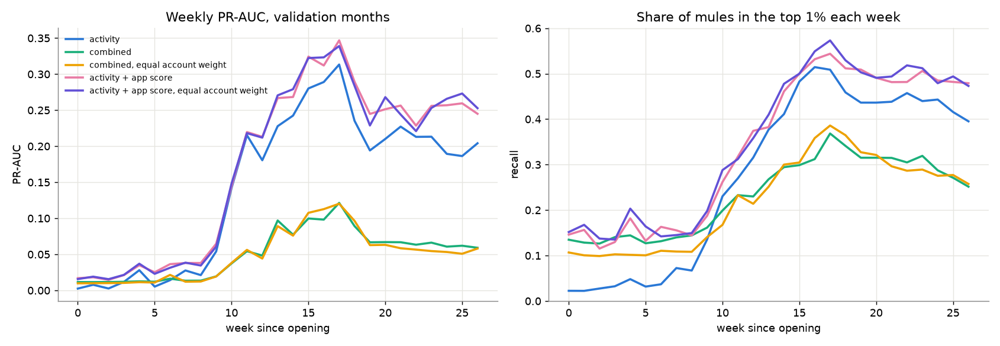

# LightGBM tuning, step 1: equal account weight and the application as one score

Settings: `{"data": "data/v1_full", "weeks": [0, 26], "folds": ["(0, 1) -> 2", "(0, 1, 2) -> 3", "(0, 1, 2, 3) -> 4"], "seed": 42, "model": "LGBMClassifier, defaults, deterministic=True; class_weight='balanced' or equal account weights", "app_score": "LogisticRegression(class_weight='balanced', max_iter=2000) on accounts_linear, 5-fold out of fold", "app_score_label": "mule_by_day at week 26", "lightgbm": "4.7.0"}`

## Conclusion

- Best validation PR-AUC: **activity**, 0.730 (activity alone 0.730, combined baseline 0.256).
- Memorising: training minus validation PR-AUC is 0.74 for the combined baseline, 0.72 with equal account weight, 0.18 with the application score and 0.09 for activity alone.
- Idea 1 (equal account weight) moves combined from 0.256 to 0.279; idea 2 (application score) gives 0.695; both together 0.699.
- Does the application add to activity? Activity + app score 0.695 vs activity alone 0.730, in 1 of 3 folds higher.
- The application score alone reaches 0.022 (logistic baseline on application columns: 0.025).
- Week by week, activity + app score has the higher PR-AUC in 27 of 27 weeks. In weeks 0-8 it puts 15% of the mules into each week's top 1%, activity alone 4%: the application buys earliness, which the account-level measure (an account's best week out of 27) does not reward.
- Real-customer mules in the account-level top 1% (3 folds): activity alone 9/14 witting and 16/18 unwitting; activity + app score 6/14 and 13/18. The application score lifts fake accounts and pushes some real mules out of a fixed budget.

## Account level, mean of 3 folds

| variant                                    |   PR-AUC training |   PR-AUC validation |     gap |   ROC-AUC validation |   precision top 1% |   recall top 1% |
|:-------------------------------------------|------------------:|--------------------:|--------:|---------------------:|-------------------:|----------------:|
| app score alone (logistic)                 |           nan     |               0.022 | nan     |                0.796 |              0.029 |           0.136 |
| activity                                   |             0.825 |               0.73  |   0.095 |                0.989 |              0.181 |           0.871 |
| combined                                   |             0.998 |               0.256 |   0.742 |                0.953 |              0.112 |           0.526 |
| combined, equal account weight             |             0.998 |               0.279 |   0.718 |                0.957 |              0.116 |           0.547 |
| activity + app score                       |             0.872 |               0.695 |   0.177 |                0.982 |              0.177 |           0.844 |
| activity + app score, equal account weight |             0.879 |               0.699 |   0.181 |                0.98  |              0.177 |           0.844 |

gap = training minus validation PR-AUC (large = memorised training accounts).

## PR-AUC by fold

| variant                                    |   PR-AUC fold 1 |   PR-AUC fold 2 |   PR-AUC fold 3 |
|:-------------------------------------------|----------------:|----------------:|----------------:|
| app score alone (logistic)                 |           0.02  |           0.022 |           0.025 |
| activity                                   |           0.672 |           0.751 |           0.767 |
| combined                                   |           0.193 |           0.173 |           0.404 |
| combined, equal account weight             |           0.159 |           0.217 |           0.461 |
| activity + app score                       |           0.624 |           0.644 |           0.816 |
| activity + app score, equal account weight |           0.66  |           0.618 |           0.818 |

## Mules in the top 1% by hidden type (caught / all, 3 folds summed)

| variant                                    | fake    | witting   | unwitting   |
|:-------------------------------------------|:--------|:----------|:------------|
| app score alone (logistic)                 | 29/178  | 0/14      | 0/18        |
| activity                                   | 158/178 | 9/14      | 16/18       |
| combined                                   | 100/178 | 4/14      | 8/18        |
| combined, equal account weight             | 104/178 | 4/14      | 8/18        |
| activity + app score                       | 159/178 | 6/14      | 13/18       |
| activity + app score, equal account weight | 158/178 | 6/14      | 14/18       |

## Weekly PR-AUC by week since opening

|   week |   activity |   combined |   combined, equal account weight |   activity + app score |   activity + app score, equal account weight |
|-------:|-----------:|-----------:|---------------------------------:|-----------------------:|---------------------------------------------:|
|      0 |      0.002 |      0.012 |                            0.01  |                  0.017 |                                        0.016 |
|      4 |      0.028 |      0.013 |                            0.011 |                  0.035 |                                        0.037 |
|      8 |      0.021 |      0.014 |                            0.012 |                  0.038 |                                        0.034 |
|     10 |      0.142 |      0.037 |                            0.038 |                  0.144 |                                        0.148 |
|     12 |      0.181 |      0.048 |                            0.044 |                  0.213 |                                        0.212 |
|     16 |      0.289 |      0.098 |                            0.113 |                  0.312 |                                        0.323 |
|     20 |      0.21  |      0.067 |                            0.063 |                  0.251 |                                        0.268 |
|     26 |      0.204 |      0.059 |                            0.058 |                  0.245 |                                        0.253 |

