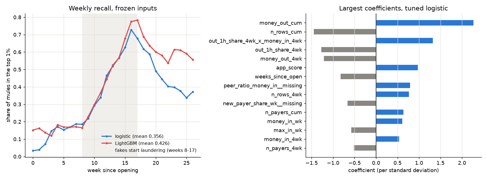

# Logistic regression: tuning and comparison with LightGBM (v1_full)

Data `data/v1_full`, months 0-4, weeks 0-26, the feature lab's 3 folds, seed 42. Inputs: the 38 frozen inputs (activity view: 37, without `app_score`). Logistic: `models.logreg.MuleLogit`, class weights balanced, L2 penalty, C searched over [0.0001, 0.001, 0.01, 0.1, 1.0, 10.0]; best C = 0.1 (highest weekly recall, mean of 3 folds). LightGBM: tuned settings `outputs/modelling/models/v1_full/lgbm_tuning_step2/tuned_params.json`.

## Search over C

|       C |   weekly_recall_mean |   catch_rules_mean |   acc_pr_auc_mean |   caught_2wk_mean |   first_caught_2wk_mean | weekly_recall_folds   | catch_rules_folds     |   weekly_recall_pooled |   seconds |
|--------:|---------------------:|-------------------:|------------------:|------------------:|------------------------:|:----------------------|:----------------------|-----------------------:|----------:|
|  0.0001 |               0.3446 |             0.0167 |            0.0268 |            0.9001 |                  0.9621 | 0.336 / 0.340 / 0.358 | 0.001 / 0.034 / 0.015 |                 0.3423 |       356 |
|  0.001  |               0.3522 |             0.0232 |            0.0258 |            0.8957 |                  0.9621 | 0.350 / 0.345 / 0.362 | 0.008 / 0.043 / 0.019 |                 0.353  |       370 |
|  0.01   |               0.3538 |             0.026  |            0.0257 |            0.8952 |                  0.9532 | 0.350 / 0.347 / 0.365 | 0.016 / 0.043 / 0.019 |                 0.3541 |       524 |
|  0.1    |               0.3557 |             0.026  |            0.0258 |            0.9056 |                  0.9532 | 0.352 / 0.346 / 0.369 | 0.016 / 0.043 / 0.019 |                 0.3562 |       663 |
|  1      |               0.3556 |             0.026  |            0.0256 |            0.9056 |                  0.9532 | 0.353 / 0.346 / 0.367 | 0.016 / 0.043 / 0.019 |                 0.3562 |       592 |
| 10      |               0.3557 |             0.026  |            0.0257 |            0.9056 |                  0.9532 | 0.355 / 0.345 / 0.367 | 0.016 / 0.043 / 0.019 |                 0.356  |       715 |

## Logistic vs LightGBM (mean of 3 folds)

|                          |   weekly_recall |   catch_rules |   acc_pr_auc |   caught_2wk |   first_caught_2wk |   rules |   weekly_recall_pooled |
|:-------------------------|----------------:|--------------:|-------------:|-------------:|-------------------:|--------:|-----------------------:|
| ('LightGBM', 'activity') |           0.357 |         0.461 |        0.872 |        0.947 |              0.956 |   0.141 |                  0.355 |
| ('LightGBM', 'frozen')   |           0.431 |         0.452 |        0.876 |        0.904 |              0.966 |   0.141 |                  0.426 |
| ('logistic', 'activity') |           0.292 |         0.01  |        0.021 |        0.92  |              0.962 |   0.141 |                  0.289 |
| ('logistic', 'frozen')   |           0.356 |         0.026 |        0.026 |        0.906 |              0.953 |   0.141 |                  0.356 |

`rules` = catch_rules of the rules' own alerts on the same months.

## Per fold

|                 |   ('catch_rules', 'LightGBM') |   ('catch_rules', 'logistic') |   ('weekly_recall', 'LightGBM') |   ('weekly_recall', 'logistic') |
|:----------------|------------------------------:|------------------------------:|--------------------------------:|--------------------------------:|
| ('activity', 1) |                         0.494 |                         0.003 |                           0.35  |                           0.303 |
| ('activity', 2) |                         0.466 |                         0.01  |                           0.366 |                           0.303 |
| ('activity', 3) |                         0.422 |                         0.019 |                           0.355 |                           0.269 |
| ('frozen', 1)   |                         0.464 |                         0.016 |                           0.428 |                           0.352 |
| ('frozen', 2)   |                         0.455 |                         0.043 |                           0.397 |                           0.346 |
| ('frozen', 3)   |                         0.436 |                         0.019 |                           0.47  |                           0.369 |

## Value of the application score (frozen - activity)

| model    |   weekly_recall |   catch_rules |   acc_pr_auc |
|:---------|----------------:|--------------:|-------------:|
| LightGBM |           0.075 |        -0.009 |        0.005 |
| logistic |           0.064 |         0.016 |        0.005 |

## Real-customer mules in the account-level top 1% (per fold)

| model    | top_1%_witting   | top_1%_unwitting   | rules_budget_witting   | rules_budget_unwitting   |
|:---------|:-----------------|:-------------------|:-----------------------|:-------------------------|
| LightGBM | 3/3 / 6/7 / 2/4  | 5/5 / 6/6 / 6/7    | 2/3 / 5/7 / 2/4        | 5/5 / 5/6 / 6/7          |
| logistic | 0/3 / 0/7 / 0/4  | 0/5 / 0/6 / 0/7    | 0/3 / 0/7 / 0/4        | 0/5 / 0/6 / 0/7          |

## Variant: interaction terms (share x log money in)

|    C |   weekly_recall_mean |   catch_rules_mean |   acc_pr_auc_mean |   caught_2wk_mean |   first_caught_2wk_mean | weekly_recall_folds   | catch_rules_folds     |   weekly_recall_pooled | rules_budget_witting   | rules_budget_unwitting   | top_1%_witting   | top_1%_unwitting   |   seconds |
|-----:|---------------------:|-------------------:|------------------:|------------------:|------------------------:|:----------------------|:----------------------|-----------------------:|:-----------------------|:-------------------------|:-----------------|:-------------------|----------:|
| 0.01 |               0.3809 |             0.4167 |            0.7239 |            0.9436 |                  0.9672 | 0.373 / 0.378 / 0.391 | 0.447 / 0.412 / 0.392 |                 0.3815 | 3/3 / 2/7 / 1/4        | 4/5 / 5/6 / 6/7          | 3/3 / 3/7 / 1/4  | 4/5 / 6/6 / 6/7    |       442 |
| 0.1  |               0.3803 |             0.4169 |            0.7281 |            0.9436 |                  0.9672 | 0.372 / 0.377 / 0.391 | 0.447 / 0.412 / 0.392 |                 0.3819 | 3/3 / 2/7 / 1/4        | 4/5 / 5/6 / 6/7          | 3/3 / 3/7 / 1/4  | 4/5 / 6/6 / 6/7    |       472 |

Final logistic: `{"C": 0.01, "interactions": true}` (higher weekly recall, mean of 3 folds; plain best 0.3557).

Train the final model: `python -m models train --out data/v1_full --model logreg --name logreg --params outputs/modelling/models/v1_full/logreg_tuning/tuned_params.json`.
