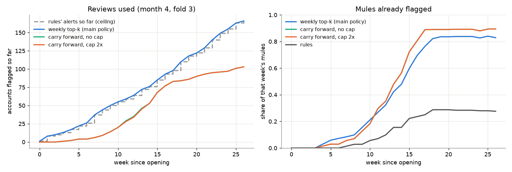
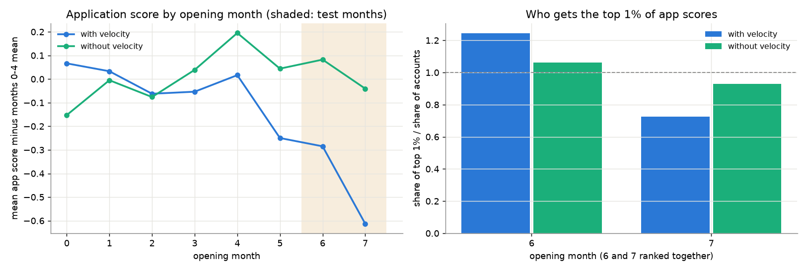

# Carry-forward budget policy and calendar drift in the application score

Data `/Users/cheepheng/aml-detection-system/data/v1_full` (this Mac's copy, run_manifest sha256 4ce1c4..., which differs from the training machine's): numbers are for comparison only. Months 0-4 only; month 5 and months 6-7 untouched (months 5-7 read only as public cleaned application columns in 2a). Tuned model `frozen_tuned` settings, 38 frozen inputs. Executed 2026-10-29 05:20 in 11 min. Notebook `notebooks/11_policy_drift.ipynb`.

## Summary

**1. Carry unused budget forward (secondary policy).** Pre-registered choice on folds 1+2, applied to fold 3. Seed 42: no cap chose quantile 0.9995, verdict **better**; cap 2x chose 0.9995, verdict **better**. Caught per fold (1 / 2 / 3), main weekly top-k 57 / 59 / 63; carry no cap 58 / 61 / 68; carry cap 58 / 61 / 68; model_anytime (upper bound) 58 / 61 / 69; rules 19 / 18 / 21. Seed SD of the main policy's catches: up to 1.2 per fold. Verdicts over seeds 42 / 1 / 2: no cap better / holds up / holds up; cap better / holds up / holds up. This is a secondary result beside the agreed main policy, never a replacement; at every week the model used no more reviews than the rules (checked).

**2. Calendar drift in the application score.** (a) Months 6+7 ranked together: month 7's share of the top 1% minus its share of accounts is -0.129 with velocity_* (2 SE 0.045) and -0.033 without. Condition (i) (clear tilt that shrinks by half or more): **True**. (b) Months 3+4 ranked together, train 0-2: caught 124 vs 125 of 146, catch_rules 0.452 vs 0.452, catch_0.1pct 0.535 vs 0.540, weekly recall 0.408 vs 0.415 (with vs without velocity_*). Condition (ii) (no measure worse than noise on any of the 4 cohorts): **False**. Recommendation to drop velocity_*: **no**; it would change the frozen app-score recipe, so a team decision either way.

Looks: 11 new candidates on the v1_full folds (10 policy candidates on folds 1-2, 2 of them on fold 3, per seed; 1 app-score variant), 11 LightGBM fits.

## Interpretation (written after the run, 29 Oct 2026)

Numbers come from this Mac's copy of `data/v1_full` (run_manifest sha256 4ce1c4..., not the training machine's copy),
so use them to compare policies and variants with each other, not as final results.

**Investigation 1: carry unused budget forward.**
- The pre-registered choice was the strictest threshold in the grid (quantile 0.9995) for all 3 seeds, with and
  without the cap. The best threshold might be stricter still. The grid was not widened, to keep the pre-registration.
- On the held-back fold 3, carrying budget forward caught **68 vs 63** mules (seed 42), 66 / 65 vs 64 (seed 1) and
  67 / 65 vs 64 (seed 2), no cap / cap. The median first flag came 1–2 days sooner (6 vs 7–8 days after the laundering
  start). Verdict: **"holds up" with all 3 seeds**. It was "better" only with seed 42: on fold 1 the gain is 0 or −1
  with seeds 1 and 2.
- Seed noise: the main policy's catches move by an SD of 0.6–1.2 accounts between seeds. Seed 42's +5 on fold 3 is
  clearly more than that. Seeds 1 and 2 gain +1 to +3, which is at the edge of the noise.
- The clearest gain is in **reviews used**. On fold 3 the policy flagged only 103 accounts where the rules raised 166
  alerts, and still caught more: precision 0.66 vs 0.38. On folds 1–2 it used 134–149 of 165–170. It nearly matches
  `model_anytime` (69 on fold 3), the upper bound that ignores the weekly fairness limit.
- The 2× weekly cap hardly matters: on fold 3 with seed 42 the cap and no-cap flags are identical (the two lines in the
  first figure overlap).
- Caveats. The threshold is set as a share of the whole month's 27 weeks of scores, so it uses the shape of future
  scores (no labels). In use it would need a threshold fixed in score units beforehand, e.g. on month 5 with the
  calibration step. Each fold has only 64–76 mules. This is a **secondary** policy beside the agreed weekly top-k,
  never a replacement.

**Investigation 2: calendar drift in the application score.**
- (a) Ranked together with month 6, **month-7 accounts get too few of the top application scores**: they are 47% of
  the test cohort's accounts but get 34% of its top 1% and 26% of its top 0.1%. The cause is the velocity columns. Their
  coefficients are positive (+0.13 for `velocity_24h`, +0.17 for `velocity_4w`), and velocity falls with the calendar
  month, so later months look safer. Without them month 7 gets 44% of the top 1% and 34% of the top 0.1%. The top-1%
  gap shrinks from −12.9 to −3.3 points (2 SE = 4.5), so condition (i) is met. Part of a tilt could be real (if month 7
  had fewer fake accounts), but that cannot be checked without labels of months 6–7.
- (b) On months 3 + 4 ranked together, dropping velocity changes almost nothing: 124 vs 125 caught of 146,
  `catch_rules` 0.452 both, `catch_0.1pct` +0.005, weekly recall +0.007. The single-month checks are mixed. Three
  measures fall by slightly more than their noise level: month 4 `catch_rules` −0.012 (noise 0.010), and on the lab's
  fold 3 `catch_0.1pct` −0.012 and weekly recall −0.013 (noise 0.008). The others rise. So condition (ii) is not met,
  but only narrowly. These are single-seed differences between two models, and the noise of a difference is about
  1.4 times the noise of one model.
- **Pre-registered recommendation: do not drop `velocity_*` (no).** Changing the frozen application-score recipe is a
  team decision either way.
- Limitation of (b). Months 3 and 4 differ much less in velocity than months 6 and 7 (`velocity_4w` −0.54 vs −0.94,
  against −1.69 vs −2.81), and the current application score shows no tilt between them (top-1% ratio 1.00). So (b)
  can show the cost of dropping the columns but not the benefit. At the rules' budget the flags split between months
  3 and 4 like the mules do, in both variants.

**Side finding.** The feature lab and notebook 08 pass `app_score` to LightGBM as float64, while `models.train` (the
frozen model) and this notebook cast it to float32. That changes LightGBM's bins: on fold 2 the weekly recall is
0.3991 vs 0.3966, which is inside seed noise.

## Investigation 1: carry unused budget forward

### Pre-registered choice and verdict per seed

|   seed | cap   |   quantile |   caught_folds12_choice |   caught_folds12_topk |   caught_f1 |   caught_f2 |   caught_f3 |   topk_caught_f1 |   topk_caught_f2 |   topk_caught_f3 |   median_days_f3 |   topk_median_days_f3 | verdict   |
|-------:|:------|-----------:|------------------------:|----------------------:|------------:|------------:|------------:|-----------------:|-----------------:|-----------------:|-----------------:|----------------------:|:----------|
|     42 | nocap |     0.9995 |                     119 |                   116 |          58 |          61 |          68 |               57 |               59 |               63 |                6 |                     7 | better    |
|     42 | cap   |     0.9995 |                     119 |                   116 |          58 |          61 |          68 |               57 |               59 |               63 |                6 |                     7 | better    |
|      1 | nocap |     0.9995 |                     118 |                   115 |          57 |          61 |          66 |               57 |               58 |               64 |                6 |                     8 | holds up  |
|      1 | cap   |     0.9995 |                     117 |                   115 |          57 |          60 |          65 |               57 |               58 |               64 |                6 |                     8 | holds up  |
|      2 | nocap |     0.9995 |                     120 |                   118 |          58 |          62 |          67 |               59 |               59 |               64 |                6 |                     7 | holds up  |
|      2 | cap   |     0.9995 |                     120 |                   118 |          58 |          62 |          65 |               59 |               59 |               64 |                6 |                     7 | holds up  |

### Seed 42: all policies per fold (fold 3 = held back)

|                      |   quantile |   flagged |   caught |   mules |   precision |   median_days_from_start |   caught_by_start_week |   catch_mean |   flagged_before_start | caught_fake   | caught_witting   | caught_unwitting   |
|:---------------------|-----------:|----------:|---------:|--------:|------------:|-------------------------:|-----------------------:|-------------:|-----------------------:|:--------------|:-----------------|:-------------------|
| (1, 'topk')          |            |       170 |       57 |      64 |       0.335 |                    6.000 |                     33 |        0.477 |                      0 | 50/56         | 2/3              | 5/5                |
| (1, 'carry_nocap')   |      1.000 |       140 |       58 |      64 |       0.414 |                    6.000 |                     30 |        0.479 |                      0 | 51/56         | 2/3              | 5/5                |
| (1, 'carry_cap')     |      1.000 |       134 |       58 |      64 |       0.433 |                    6.000 |                     30 |        0.479 |                      0 | 51/56         | 2/3              | 5/5                |
| (1, 'model_anytime') |            |       170 |       58 |      64 |       0.341 |                    6.000 |                     32 |        0.480 |                      0 | 51/56         | 2/3              | 5/5                |
| (1, 'rules')         |            |       165 |       19 |      64 |       0.115 |                    6.000 |                      2 |        0.146 |                      0 | 17/56         | 0/3              | 2/5                |
| (2, 'topk')          |            |       165 |       59 |      70 |       0.358 |                    8.000 |                     24 |        0.453 |                      0 | 49/57         | 5/7              | 5/6                |
| (2, 'carry_nocap')   |      1.000 |       149 |       61 |      70 |       0.409 |                    7.000 |                     30 |        0.467 |                      0 | 51/57         | 4/7              | 6/6                |
| (2, 'carry_cap')     |      1.000 |       146 |       61 |      70 |       0.418 |                    7.000 |                     29 |        0.466 |                      0 | 51/57         | 4/7              | 6/6                |
| (2, 'model_anytime') |            |       165 |       61 |      70 |       0.370 |                    7.000 |                     30 |        0.467 |                      0 | 51/57         | 4/7              | 6/6                |
| (2, 'rules')         |            |       150 |       18 |      70 |       0.120 |                   10.000 |                      2 |        0.132 |                      0 | 14/57         | 2/7              | 2/6                |
| (3, 'topk')          |            |       166 |       63 |      76 |       0.380 |                    7.000 |                     30 |        0.436 |                      2 | 55/65         | 2/4              | 6/7                |
| (3, 'carry_nocap')   |      1.000 |       103 |       68 |      76 |       0.660 |                    6.000 |                     36 |        0.468 |                      0 | 60/65         | 2/4              | 6/7                |
| (3, 'carry_cap')     |      1.000 |       103 |       68 |      76 |       0.660 |                    6.000 |                     36 |        0.468 |                      0 | 60/65         | 2/4              | 6/7                |
| (3, 'model_anytime') |            |       166 |       69 |      76 |       0.416 |                    6.000 |                     39 |        0.488 |                      1 | 61/65         | 2/4              | 6/7                |
| (3, 'rules')         |            |       152 |       21 |      76 |       0.138 |                    5.000 |                      5 |        0.143 |                      0 | 18/65         | 0/4              | 3/7                |

### Gain over the main policy (chosen quantile)

|   seed | cap   |   fold |   d_caught |   d_median_days |   d_caught_by_start_week |   d_catch_mean |   d_precision |
|-------:|:------|-------:|-----------:|----------------:|-------------------------:|---------------:|--------------:|
|     42 | nocap |      1 |          1 |           0.000 |                       -3 |          0.002 |         0.079 |
|     42 | nocap |      2 |          2 |          -1.000 |                        6 |          0.015 |         0.052 |
|     42 | nocap |      3 |          5 |          -1.000 |                        6 |          0.032 |         0.281 |
|     42 | cap   |      1 |          1 |           0.000 |                       -3 |          0.002 |         0.098 |
|     42 | cap   |      2 |          2 |          -1.000 |                        5 |          0.014 |         0.060 |
|     42 | cap   |      3 |          5 |          -1.000 |                        6 |          0.032 |         0.281 |
|      1 | nocap |      1 |          0 |          -1.000 |                        4 |          0.001 |         0.078 |
|      1 | nocap |      2 |          3 |          -1.000 |                        6 |          0.026 |         0.058 |
|      1 | nocap |      3 |          2 |          -2.000 |                        8 |          0.031 |         0.237 |
|      1 | cap   |      1 |          0 |          -1.000 |                        4 |          0.001 |         0.090 |
|      1 | cap   |      2 |          2 |          -1.000 |                        5 |          0.018 |         0.059 |
|      1 | cap   |      3 |          1 |          -2.000 |                        8 |          0.023 |         0.239 |
|      2 | nocap |      1 |         -1 |          -1.000 |                        4 |         -0.011 |         0.089 |
|      2 | nocap |      2 |          3 |          -0.500 |                        5 |          0.021 |         0.045 |
|      2 | nocap |      3 |          3 |          -1.000 |                        3 |          0.024 |         0.235 |
|      2 | cap   |      1 |         -1 |          -1.000 |                        4 |         -0.011 |         0.106 |
|      2 | cap   |      2 |          3 |          -0.500 |                        5 |          0.021 |         0.056 |
|      2 | cap   |      3 |          1 |          -1.000 |                        3 |          0.007 |         0.234 |

### Seed noise of the main policy (3 seeds)

|   fold |   caught |   catch_mean |   median_days_from_start |
|-------:|---------:|-------------:|-------------------------:|
|      1 |    1.155 |        0.011 |                    0.577 |
|      2 |    0.577 |        0.005 |                    0.577 |
|      3 |    0.577 |        0.007 |                    0.577 |

- topk: the agreed main policy (score.permanent_flags). carry: evaluation.policy.carry_forward_flags with the quantile chosen on folds 1+2. model_anytime: score.anytime_flags, same total flags spent at any time (not fair week by week; upper bound). rules: the rules' first alerts.
- tau is a quantile of the whole month's 27 weeks of scores, known only at the end of the horizon; in use it would be fixed in score units beforehand (e.g. on month 5). No label is involved, but the result is optimistic in that respect.

## Investigation 2: calendar drift in the application score

### (a) App score per opening month (label-free for months 5-7)

|   open_month |   ('mean', 'with velocity') |   ('mean', 'without velocity') |   ('p99', 'with velocity') |   ('p99', 'without velocity') |   ('p99.9', 'with velocity') |   ('p99.9', 'without velocity') |
|-------------:|----------------------------:|-------------------------------:|---------------------------:|------------------------------:|-----------------------------:|--------------------------------:|
|            0 |                      -0.786 |                         -0.983 |                      2.282 |                         2.003 |                        3.399 |                           3.054 |
|            1 |                      -0.819 |                         -0.836 |                      2.229 |                         2.141 |                        3.222 |                           3.179 |
|            2 |                      -0.915 |                         -0.907 |                      2.138 |                         2.082 |                        3.156 |                           3.094 |
|            3 |                      -0.906 |                         -0.792 |                      2.318 |                         2.367 |                        3.294 |                           3.350 |
|            4 |                      -0.836 |                         -0.635 |                      2.318 |                         2.433 |                        3.100 |                           3.200 |
|            5 |                      -1.102 |                         -0.787 |                      1.886 |                         2.139 |                        2.833 |                           3.072 |
|            6 |                      -1.137 |                         -0.748 |                      1.915 |                         2.233 |                        2.886 |                           3.159 |
|            7 |                      -1.465 |                         -0.871 |                      1.621 |                         2.167 |                        2.510 |                           2.971 |

### (a) Share of the top 0.1% / 1% when months are ranked together

|   open_month |   accounts |   share_accounts |   top_0.001_k |   top_0.001_n |   top_0.001_share |   top_0.001_ratio |   top_0.01_k |   top_0.01_n |   top_0.01_share |   top_0.01_ratio | variant          | ranked_together   |
|-------------:|-----------:|-----------------:|--------------:|--------------:|------------------:|------------------:|-------------:|-------------:|-----------------:|-----------------:|:-----------------|:------------------|
|            6 |      26529 |            0.530 |            50 |            37 |             0.740 |             1.396 |          501 |          330 |            0.659 |            1.243 | with velocity    | 6+7               |
|            7 |      23532 |            0.470 |            50 |            13 |             0.260 |             0.553 |          501 |          171 |            0.341 |            0.726 | with velocity    | 6+7               |
|            3 |      36724 |            0.540 |            68 |            44 |             0.647 |             1.198 |          680 |          368 |            0.541 |            1.002 | with velocity    | 3+4               |
|            4 |      31279 |            0.460 |            68 |            24 |             0.353 |             0.767 |          680 |          312 |            0.459 |            0.998 | with velocity    | 3+4               |
|            6 |      26529 |            0.530 |            50 |            33 |             0.660 |             1.245 |          501 |          282 |            0.563 |            1.062 | without velocity | 6+7               |
|            7 |      23532 |            0.470 |            50 |            17 |             0.340 |             0.723 |          501 |          219 |            0.437 |            0.930 | without velocity | 6+7               |
|            3 |      36724 |            0.540 |            68 |            44 |             0.647 |             1.198 |          680 |          343 |            0.504 |            0.934 | without velocity | 3+4               |
|            4 |      31279 |            0.460 |            68 |            24 |             0.353 |             0.767 |          680 |          337 |            0.496 |            1.077 | without velocity | 3+4               |

Velocity coefficients in the frozen recipe: {'velocity_6h': -0.018, 'velocity_24h': 0.128, 'velocity_4w': 0.166}. Rank correlation of the two scores over all accounts: 0.968.

### Columns that move most with the calendar (months 6+7 vs 0-4, in SD of months 0-4)

|                                  |   shift_sd |   coef |
|:---------------------------------|-----------:|-------:|
| velocity_4w                      |     -2.218 |  0.166 |
| velocity_24h                     |     -1.318 |  0.128 |
| velocity_6h                      |     -0.858 | -0.018 |
| zip_count_4w                     |     -0.697 | -0.013 |
| date_of_birth_distinct_emails_4w |     -0.497 | -0.201 |
| credit_risk_score                |      0.288 |  0.015 |
| income                           |      0.279 |  0.157 |
| session_length_in_minutes        |     -0.208 |  0.021 |
| phone_home_valid                 |      0.153 | -0.637 |
| email_is_free                    |     -0.136 |  0.315 |

### (b) Mixed cohort on the folds (seed 42)

| variant          | cohort              | train_months   |   budget |   flagged |   caught |   mules |   precision |   median_days_from_start |   catch_rules |   catch_0.1pct |   weekly_recall |
|:-----------------|:--------------------|:---------------|---------:|----------:|---------:|--------:|------------:|-------------------------:|--------------:|---------------:|----------------:|
| with velocity    | months 3+4 together | 0-2            |      331 |       331 |      124 |     146 |       0.375 |                    7.000 |         0.452 |          0.535 |           0.408 |
| with velocity    | month 3             | 0-2            |      165 |       165 |       59 |      70 |       0.358 |                    8.000 |         0.453 |          0.533 |           0.397 |
| with velocity    | month 4             | 0-2            |      166 |       166 |       63 |      76 |       0.380 |                    6.000 |         0.430 |          0.532 |           0.415 |
| with velocity    | month 4, lab fold 3 | 0-3            |      166 |       166 |       63 |      76 |       0.380 |                    7.000 |         0.436 |          0.562 |           0.465 |
| without velocity | months 3+4 together | 0-2            |      331 |       331 |      125 |     146 |       0.378 |                    7.000 |         0.452 |          0.540 |           0.415 |
| without velocity | month 3             | 0-2            |      165 |       165 |       59 |      70 |       0.358 |                    8.000 |         0.456 |          0.538 |           0.409 |
| without velocity | month 4             | 0-2            |      166 |       166 |       63 |      76 |       0.380 |                    7.000 |         0.418 |          0.541 |           0.421 |
| without velocity | month 4, lab fold 3 | 0-3            |      166 |       166 |       64 |      76 |       0.386 |                    8.000 |         0.436 |          0.551 |           0.452 |

Without minus with velocity_*:

| cohort              |   catch_rules |   catch_0.1pct |   weekly_recall |   caught |   median_days_from_start |   precision |
|:--------------------|--------------:|---------------:|----------------:|---------:|-------------------------:|------------:|
| months 3+4 together |         0.001 |          0.005 |           0.007 |        1 |                    0.000 |       0.003 |
| month 3             |         0.003 |          0.005 |           0.012 |        0 |                    0.000 |       0.000 |
| month 4             |        -0.012 |          0.008 |           0.006 |        0 |                    1.000 |       0.000 |
| month 4, lab fold 3 |         0.000 |         -0.012 |          -0.013 |        1 |                    1.000 |       0.006 |

Noise levels: {"catch_rules": 0.01, "catch_0.1pct": 0.008, "weekly_recall": 0.008, "caught": 1.155}.

### (b) Where the mixed cohort's flags go

|   open_month |   flags |   share_flags |   mules |   share_mules | flags_from   | variant          |
|-------------:|--------:|--------------:|--------:|--------------:|:-------------|:-----------------|
|            3 |     157 |         0.474 |      70 |         0.479 | rules budget | with velocity    |
|            4 |     174 |         0.526 |      76 |         0.521 | rules budget | with velocity    |
|            3 |     920 |         0.501 |      70 |         0.479 | 0.1% a week  | with velocity    |
|            4 |     916 |         0.499 |      76 |         0.521 | 0.1% a week  | with velocity    |
|            3 |     155 |         0.468 |      70 |         0.479 | rules budget | without velocity |
|            4 |     176 |         0.532 |      76 |         0.521 | rules budget | without velocity |
|            3 |     902 |         0.491 |      70 |         0.479 | 0.1% a week  | without velocity |
|            4 |     934 |         0.509 |      76 |         0.521 | 0.1% a week  | without velocity |

