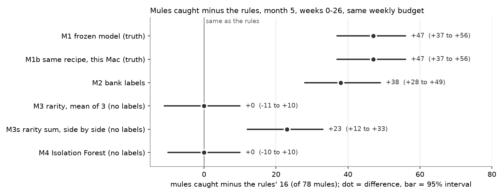
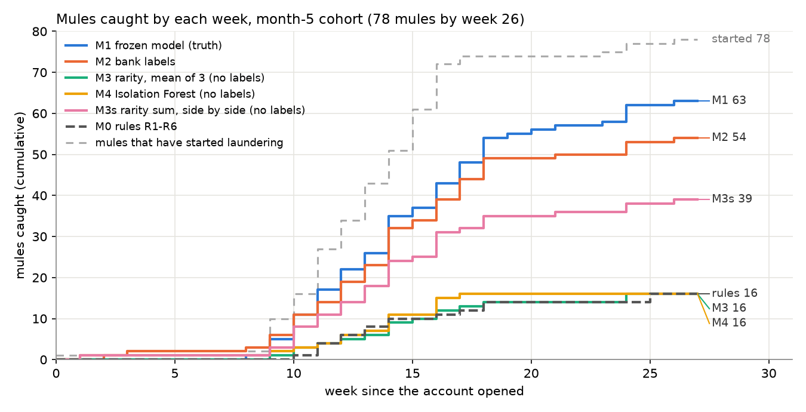

# Outlier appendix: the one look on month 5

Data `data/v1_full` (this Mac's copy, run_manifest sha256 4ce1c4...). Month-5 cohort, weeks 0-26, 78 mules, 124 flags per method at the rules' weekly budget, permanent flags. Settings frozen 2026-10-31 18:24 (PR #49); the one look ran 2026-10-31 19:03 on commit 39119ed. Written by `notebooks/12_outlier_detection.ipynb` from the look's committed outputs only (no data folder, no label read), 2026-10-31 19:56. Plan: `outputs/modelling/outlier/PLAN.md`.

## Summary

- **No labels:** rarity (M3) 16 and Isolation Forest (M4) 16 vs the rules 16 of 78: a tie. ECOD's sum (M3s, side by side only) 39.
- **Bank labels:** M2 54 vs M1b 63 (-9, 95% interval -16 to -2); the model of record M1 63 (month5_dryrun_v2: 63).
- **Hidden mules** (never confirmed, 62): rules 3, M1 50, M2 42, M3 12, M4 13, M3s 30.

## Main table

|              | method                                   |   flagged |   caught |   precision |   recall_final_label |   median_days_from_start |   flagged_before_start | caught_fake   | caught_witting   | caught_unwitting   | both   | model_only   | rules_only   |
|:-------------|:-----------------------------------------|----------:|---------:|------------:|---------------------:|-------------------------:|-----------------------:|:--------------|:-----------------|:-------------------|:-------|:-------------|:-------------|
| rules        | M0 rules R1-R6                           |       119 |       16 |       0.134 |                0.165 |                      8.5 |                      0 | 13/70         | 3/5              | 0/3                | <NA>   | <NA>         | <NA>         |
| frozen_tuned | M1 frozen model (truth)                  |       124 |       63 |       0.508 |                0.649 |                      8   |                      0 | 59/70         | 3/5              | 1/3                | 14     | 49           | 2            |
| truth_macos  | M1b same recipe, this Mac (truth)        |       124 |       63 |       0.508 |                0.649 |                     10   |                      0 | 59/70         | 3/5              | 1/3                | 14     | 49           | 2            |
| bank_label   | M2 bank labels                           |       124 |       54 |       0.435 |                0.557 |                      9   |                      2 | 50/70         | 3/5              | 1/3                | 13     | 41           | 3            |
| rarity       | M3 rarity, mean of 3 (no labels)         |       124 |       16 |       0.129 |                0.165 |                      9   |                      0 | 14/70         | 2/5              | 0/3                | 4      | 12           | 12           |
| rarity_sum   | M3s rarity sum, side by side (no labels) |       124 |       39 |       0.315 |                0.402 |                      8   |                      0 | 34/70         | 4/5              | 1/3                | 10     | 29           | 6            |
| iforest      | M4 Isolation Forest (no labels)          |       124 |       16 |       0.129 |                0.165 |                     12.5 |                      0 | 15/70         | 1/5              | 0/3                | 4      | 12           | 12           |

## Paired differences (1,000 account-level resamples)

Against the rules:

|                                          |   difference |   low_95 |   high_95 | clear   |
|:-----------------------------------------|-------------:|---------:|----------:|:--------|
| M1 frozen model (truth)                  |           47 |   37     |        56 | True    |
| M1b same recipe, this Mac (truth)        |           47 |   37     |        56 | True    |
| M2 bank labels                           |           38 |   27.975 |        49 | True    |
| M3 rarity, mean of 3 (no labels)         |            0 |  -11     |        10 | False   |
| M3s rarity sum, side by side (no labels) |           23 |   12     |        33 | True    |
| M4 Isolation Forest (no labels)          |            0 |  -10     |        10 | False   |

Other pairs:

|                            |   difference |   low_95 |   high_95 | clear   |
|:---------------------------|-------------:|---------:|----------:|:--------|
| bank_label - truth_macos   |           -9 |      -16 |        -2 | True    |
| truth_macos - frozen_tuned |            0 |       -4 |         4 | False   |
| rarity - iforest           |            0 |      -10 |         9 | False   |
| rarity_sum - rarity        |           23 |       15 |        32 | True    |
| rarity_sum - iforest       |           23 |       14 |        32 | True    |
| bank_label - rarity_sum    |           15 |        5 |        25 | True    |

## Mules caught by week

## Hidden mules

|                 |   mules |   rules |   frozen_tuned |   truth_macos |   bank_label |   rarity |   rarity_sum |   iforest |
|:----------------|--------:|--------:|---------------:|--------------:|-------------:|---------:|-------------:|----------:|
| never confirmed |      62 |       3 |             50 |            50 |           42 |       12 |           30 |        13 |
| bank confirmed  |      16 |      13 |             13 |            13 |           12 |        4 |            9 |         3 |

By type:

| group     |   mules |   rules |   frozen_tuned |   truth_macos |   bank_label |   rarity |   rarity_sum |   iforest |
|:----------|--------:|--------:|---------------:|--------------:|-------------:|---------:|-------------:|----------:|
| fake      |      70 |      13 |             59 |            59 |           50 |       14 |           34 |        15 |
| witting   |       5 |       3 |              3 |             3 |            3 |        2 |            4 |         1 |
| unwitting |       3 |       0 |              1 |             1 |            1 |        0 |            1 |         0 |

## Who catches whom

Row catches, column misses:

|              |   rules |   frozen_tuned |   truth_macos |   bank_label |   rarity |   rarity_sum |   iforest |
|:-------------|--------:|---------------:|--------------:|-------------:|---------:|-------------:|----------:|
| rules        |       0 |              2 |             2 |            3 |       12 |            6 |        12 |
| frozen_tuned |      49 |              0 |             2 |           10 |       49 |           29 |        50 |
| truth_macos  |      49 |              2 |             0 |           11 |       49 |           28 |        49 |
| bank_label   |      41 |              1 |             2 |            0 |       40 |           21 |        44 |
| rarity       |      12 |              2 |             2 |            2 |        0 |            1 |        12 |
| rarity_sum   |      29 |              5 |             4 |            6 |       24 |            0 |        26 |
| iforest      |      12 |              3 |             2 |            6 |       12 |            3 |         0 |

|                                           |   mules |
|:------------------------------------------|--------:|
| rarity and iforest both                   |       4 |
| rarity or iforest                         |      28 |
| rarity or iforest, missed by bank_label   |       8 |
| of them never confirmed                   |       5 |
| rarity or iforest, missed by frozen_tuned |       5 |
| rules or rarity                           |      28 |
| rules or iforest                          |      28 |
| rules or bank_label                       |      57 |

## By laundering pattern

| group                |   mules |   rules |   frozen_tuned |   truth_macos |   bank_label |   rarity |   rarity_sum |   iforest |
|:---------------------|--------:|--------:|---------------:|--------------:|-------------:|---------:|-------------:|----------:|
| Structuring          |      28 |       4 |             23 |            24 |           21 |       12 |           22 |         8 |
| Deposit-Send         |      12 |       2 |              9 |             9 |            6 |        0 |            5 |         5 |
| Behavioural_Change_1 |       6 |       0 |              3 |             3 |            2 |        0 |            1 |         0 |
| Behavioural_Change_2 |       6 |       1 |              4 |             5 |            4 |        0 |            1 |         0 |
| Fan_In               |       5 |       3 |              5 |             5 |            5 |        2 |            2 |         1 |
| Gather-Scatter       |       5 |       2 |              5 |             5 |            4 |        0 |            2 |         1 |
| Cycle                |       3 |       1 |              3 |             2 |            2 |        1 |            2 |         0 |
| Fan_Out              |       3 |       2 |              3 |             3 |            3 |        0 |            1 |         0 |
| Layered_Fan_In       |       3 |       0 |              2 |             2 |            2 |        0 |            1 |         0 |
| Bipartite            |       2 |       0 |              2 |             1 |            2 |        0 |            1 |         0 |
| Cash_Withdrawal      |       2 |       1 |              2 |             2 |            1 |        1 |            1 |         1 |
| Scatter-Gather       |       2 |       0 |              1 |             1 |            1 |        0 |            0 |         0 |
| Layered_Fan_Out      |       1 |       0 |              1 |             1 |            1 |        0 |            0 |         0 |

## Top 20 false alarms per method: median of each input

|                         |   frozen_tuned |   truth_macos |   bank_label |   rarity |   rarity_sum |   iforest |
|:------------------------|---------------:|--------------:|-------------:|---------:|-------------:|----------:|
| passthrough_wk          |           1    |          1    |         1    |     1    |         1    |      1    |
| out_1h_share_wk         |           0.31 |          0.26 |         0.13 |     0.33 |         0.45 |      0.28 |
| out_24h_share_wk        |           0.8  |          0.7  |         0.48 |     2.49 |         2.37 |      0.73 |
| med_in_out_minutes_wk   |        3359.22 |       4593.27 |      3844.49 |   497.18 |       622.75 |   1434.47 |
| n_payers_wk             |           1    |          1    |         1    |    12    |        10    |      2    |
| n_payees_wk             |           4    |          4    |         4    |     4    |         5    |      4.5  |
| new_payer_share_wk      |           1    |          1    |         0.71 |     1    |         1    |      1    |
| self_vs_past_money_in   |           1.87 |          1.2  |         1.42 |     3.44 |         4.89 |     19.53 |
| self_vs_past_payers     |           1    |          0.5  |         1    |    14    |        11    |      1    |
| self_vs_past_rows       |           1    |          1    |         1.2  |    11    |        10    |      2    |
| peer_ratio_money_in     |           7.57 |          7.23 |        30    |     4.32 |         4.28 |     15.96 |
| internal_out_share_cum  |           0.03 |          0.03 |         0.02 |     0.03 |         0.04 |      0.04 |
| cash_in_share_cum       |           0    |          0    |         0    |     0    |         0    |      0    |
| abroad_out_share_cum    |           0    |          0    |         0    |     0    |         0    |      0.1  |
| high_risk_out_share_cum |           0    |          0    |         0    |     0    |         0    |      0.02 |
| out_1h_share_4wk        |           0.16 |          0.15 |         0.07 |     0.03 |         0.06 |      0.05 |
| out_24h_share_4wk       |           0.3  |          0.36 |         0.29 |     0.22 |         0.26 |      0.21 |
| passthrough_4wk         |           0.94 |          0.98 |         0.85 |     0.63 |         0.74 |      0.73 |
| n_payers_4wk            |           4    |          4    |         3    |    15    |        12.5  |      5    |
| weeks_since_open        |          19.5  |         20    |         3.5  |    13.5  |        18    |      3    |

## Against the reading written before the look

| pre-written result                      | holds    | evidence                                                                                |
|:----------------------------------------|:---------|:----------------------------------------------------------------------------------------|
| M3/M4 > M0                              | False    | rarity +0 (-11 to +10), iforest +0 (-10 to +10) vs the rules                            |
| M3/M4 = M0 or below                     | True     | neither interval excludes 0                                                             |
| M2 close to M1b                         | False    | M2 54 vs M1b 63: -9 (-16 to -2); keeps 86% of M1b's catches                             |
| M2 far below M1b                        | judgment | a clear loss of 9, but +38 vs the rules                                                 |
| M3/M4 catch hidden mules that M2 misses | True     | 5 never-confirmed mules (of 8 missed by M2), with two methods' flags = twice the budget |

## Interpretation (written after the run, 31 Oct 2026)

One month, 78 mules: every count below moves by about ±10 between resamples, so only the differences whose
interval excludes 0 count as results.

**1. No labels: the pre-chosen detectors tie the rules.** Rarity (M3) and Isolation Forest (M4) each catch 16 of 78,
the same as the rules (difference 0; 95% interval −11 to +10 and −10 to +10). By the table written before the look,
outlier detection alone is not enough here: our supervised result depends on labels. They are also not just the rules
again. Each shares only 4 of its 16 catches with the rules, so the rules and rarity together catch 28 (at twice the
budget). Isolation Forest catches later than every other method (median 12.5 days after the start vs 8–10).

**2. The aggregation matters more than the method.** ECOD's own sum over all 19 inputs (M3s) catches 39: 23 more than
the rules (12 to 33) and 23 more than the pre-chosen mean of the 3 rarest (15 to 32). The gap is mostly two patterns:
Structuring (22 of 28 vs 12) and Deposit-Send (5 of 12 vs 0). A plausible reason, not checked: these bursts are
moderately unusual on many inputs at once, which a sum adds up and a top-3 mean ignores. The review of 30 Oct chose
the top-3 mean because a sum favours busy ordinary accounts; on this look that choice was the worse one. M3s was fixed
in advance as a side-by-side comparison, never used to choose, so we report it as a finding to confirm on fresh data,
not as the appendix's answer.

**3. Bank labels: a clear but moderate loss.** Trained only on the mules the bank confirmed, M2 catches 54 vs 63 for
the same recipe on the truth (M1b): 9 fewer (2 to 16), 86% of the catches kept, and still 38 more than the rules
(28 to 49). Of the 62 mules the bank never confirmed, M2 catches 42 (M1b 50, rules 3). The 30 Oct review warned that
bank labels teach "find the rules' mules, earlier", because every confirmed mule was first alerted by the rules. The
result says M2 learns more than that: most of its catches are mules the rules never confirmed, mostly fake accounts
(50 of 70), which look alike whether or not the bank caught them. Read against the pre-written table: the main result
survives realistic labels, but it is a best case by about 9 of 63 catches, and the report should state that cost as
a limitation.

**4. Hidden mules.** The rules catch 3 of the 62 never-confirmed mules, by construction: the bank's confirmations come
from the rules' own alerts. The model of record catches 50 of them. This is the plainest way to show what the bank's
labels miss.

**5. Labels and outliers find some different mules, but not many.** Rarity and Isolation Forest together catch 8
mules that M2 misses, 5 of them never confirmed. That is a weak case for combining them, and it uses two methods'
flags, so twice the budget; a fair test would give a combined score the same 124 flags, which this appendix did not
fix in advance.

**6. What "unusual but innocent" looks like.** The rarity scores' top false alarms are fan-in weeks: a median of 10–12
payers in the week, 11–14 times the account's own past, money passed on within about 8–10 hours (median). Group collections look like this
(in the sensitivity runs, rule R3's false alarms moved with group-collection size). Isolation Forest's are young accounts (median week 3) with money in
20 times their own past and 16 times their peers, some abroad. The truth-trained models' (M1, M1b) are older
accounts (median week about 20) that pass all their money through; M2's are young (median week 3.5) with money in 30 times their peers.

**Caveats.** One month and 78 mules. The look ran on 31 Oct, earlier than the planned 6 Nov, but after the settings
were frozen and committed, so the result was not tuned to the data. A smoke run on month 4 had shown in-sample counts
before two settings changed (disclosed in the plan). The 19 inputs come from features chosen in Phase 1 by looking at
labels, so even the "label-free" detectors know what laundering looks like; a bank with truly no labels would start
from more generic features. Numbers come from this Mac's copy of the data; the model of record catches the same 63 as
its earlier month-5 run on this copy.
